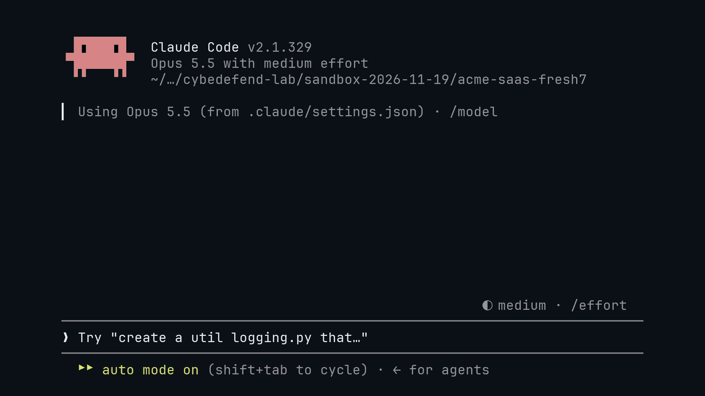

<p align="center">
  <a href="https://cybedefend.com"></a>
</p>

<p align="center"><strong>Un comando en tu agente de código. Una auditoría de seguridad completa. Cada fallo demostrado con un exploit.</strong><br>
La alternativa open source a Snyk: AppSec agéntica y autoalojada, con un escáner de IA que ejecuta tu agente de código.</p>

<p align="center">
  <a href="https://github.com/CybeDefend/cybedefend/tags"></a>
  <a href="LICENSE"></a>
  <a href="https://discord.gg/UPzm4n6SAJ"></a>
  <a href="https://www.linkedin.com/company/101144768"></a>
</p>

<p align="center"><a href="#quick-start">Install</a> &bull; <a href="deploy/community/README.md">Docs</a> &bull; <a href="https://cybedefend.com">Website</a> &bull; <a href="https://discord.gg/UPzm4n6SAJ">Discord</a></p>

<p align="center"><a href="README.md">English</a> &bull; <a href="README.fr.md">Français</a> &bull; <a href="README.zh-CN.md">中文</a> &bull; <a href="README.ja.md">日本語</a> &bull; <a href="README.ko.md">한국어</a> &bull; <a href="README.es.md">Español</a> &bull; <a href="README.pt-BR.md">Português</a></p>

> [!NOTE]
> Lanzamos en Product Hunt el 4 de diciembre de 2026. Ven a hablar con nosotros en [Discord](https://discord.gg/UPzm4n6SAJ).

**① Una auditoría completa en un comando.**
Escribe `/cybedefend` en tu agente de código. Los escáneres open source se ejecutan, el escáner de IA busca lo que ellos no pueden ver, y tu agente evalúa cada hallazgo contra tu código. Responde **SHIP**, o **NOT YET** con lo que bloquea y la corrección de cada punto.

**② Cada fallo demostrado.**
El escáner de IA escribe cada exploit como un test en la suite de tests de tu propio repositorio. Un hallazgo es un hecho, no una suposición.

**③ Toda una plataforma AppSec open source detrás.**
La alojas tú: un dashboard para tu equipo, políticas que deciden qué bloquea, integraciones con tu stack y un servidor MCP que lee tu agente de código.

<p align="center"></p>

<p align="center">Si demuestra un fallo en tu código, una estrella ayuda a otros desarrolladores a encontrarlo.</p>

<br>

<a id="quick-start"></a>
# Inicio rápido

```bash
npx skills add CybeDefend/cybedefend -g
```

Abre tu agente de código en el repositorio que quieres auditar y escribe:

```text
/cybedefend
```

Esa es toda la instalación. Ningún token que copiar, ningún archivo que editar, ningún servidor que arrancar.

- **Funciona con** Claude Code, Codex, Cursor y cualquier agente de código que lea skills.
- **Necesita** Docker en marcha, con Docker Compose 2.24.4 o posterior, unos 4 GB de memoria, git y Node.js.
- **Responde** **SHIP**, o **NOT YET** con lo que bloquea y la corrección de cada punto.

<details>
<summary><b>Lo que la primera ejecución configura por sí sola</b></summary>

<br>

No pregunta nada:

1. Arranca el dashboard en tu máquina con Docker Compose, en el primer puerto libre a partir del 8080, enlazado a `127.0.0.1`. La primera vez, Docker descarga las imágenes (unos 6 GB, unos minutos). Las ejecuciones siguientes tardan segundos y no cambian nada.
2. Crea el primer administrador y un token de acceso personal, guardado en `~/.cybedefend/appsec/credentials.json` (modo 600, nunca se imprime).
3. Crea el proyecto de tu repositorio y una política por defecto cuando tu equipo no tiene ninguna: los hallazgos críticos y altos bloquean, también cualquier secreto en el código, y los hallazgos medios avisan.
4. Conecta el servidor MCP a Claude Code. Para otro agente, imprime la dirección que hay que añadir.

Cuando las imágenes publicadas no se pueden descargar, la primera ejecución las compila desde el código fuente y lo indica (de 15 a 30 minutos, una sola vez).

</details>

<br>

# Cómo funciona

Un comando. Cinco pasos. Un veredicto.

| Paso | Qué ocurre |
|---|---|
| **1.&nbsp;Escáneres** | Los escáneres open source encuentran los patrones conocidos. |
| **2.&nbsp;Escáner&nbsp;de&nbsp;IA** | Tu agente de código mapea cada punto de entrada, anota lo que el código nunca debe permitir, busca fallos de lógica de negocio, permisos de acceso, tenants, identidad y condiciones de carrera, y demuestra cada fallo con un exploit escrito como test en tu propia suite. |
| **3.&nbsp;Triaje** | Tu agente evalúa cada hallazgo de los escáneres contra tu código. |
| **4.&nbsp;Dashboard** | Tus políticas dan el veredicto: **SHIP** o **NOT YET**. |
| **5.&nbsp;Informe** | Lo que bloquea y la corrección de cada punto. |

**Tu propio agente de código ejecuta el escáner de IA.** Ningún modelo adicional, ninguna clave de API.

**Seguro de ejecutar.** La auditoría no cambia nada del código de la aplicación. El escáner de IA no envía ninguna petición a un sistema desplegado ni a un tercero, y no usa credenciales reales ni datos personales.

<details>
<summary><b>Qué hace exactamente el escáner de IA</b></summary>

<br>

Enumera cada punto de entrada del código (rutas, consumidores de mensajes, tareas programadas, webhooks), una fila por cada uno, con quién puede llamarlo y la comprobación que lo impone. Escribe las garantías del código en frases sencillas: un miembro solo ve los documentos de su propio equipo, una transferencia nunca deja un saldo por debajo de cero.

La primera ejecución revisa todo el repositorio. Las siguientes revisan lo que cambió la rama y los puntos de entrada que llegan hasta ello. Cada fila dentro de ese alcance se revisa, rol por rol.

Una pista se convierte en hallazgo cuando un test en tu propio framework de tests falla por el motivo que afirma. Cualquier otra pista va al dashboard como una nota que no puede bloquear.

El informe cuenta los puntos de entrada revisados, los hallazgos conservados y los hallazgos descartados, con los motivos.

</details>

<details>
<summary><b>Qué bloquea exactamente</b></summary>

<br>

Las políticas se aplican a una organización, un equipo o un proyecto. Se escriben en YAML, que puedes importar y exportar. Cada regla filtra los hallazgos por severidad, puntuación CVSS, CWE, categoría OWASP, tipo de escáner, antigüedad o rama, solos o combinados.

Una regla Block hace que el veredicto sea NOT YET, y `/cybedefend` termina con el código 1. Una regla Warn registra la infracción. Las políticas vuelven a evaluar al final de cada escaneo y de cada importación.

</details>

<br>

# La plataforma

Detrás del comando, una plataforma AppSec open source completa. La alojas tú, tu equipo trabaja en ella y tu agente de código la lee a través del servidor MCP.

### Toda la organización en una sola vista

<p align="center"></p>

### Cada hallazgo, rama por rama

<p align="center"></p>

### Tus políticas deciden qué bloquea

<p align="center"></p>

<details>
<summary><b>Todo lo que incluye la edición open source</b></summary>

<br>

| Funcionalidad | Lo que obtienes |
|---|---|
| **Hallazgos que siguen al código** | Resueltos cuando el escaneo sale limpio, reabiertos cuando vuelven |
| **Políticas de seguridad** | Reglas Block y Warn, en YAML |
| **Organizaciones, equipos, roles** | Cuatro roles de organización, cuatro roles de equipo |
| **Puntuación de riesgo por proyecto** | Un nivel CybeRisk, los de mayor riesgo primero |
| **Informes** | OWASP Top 10 y CWE Top 25, en PDF, HTML o JSON |
| **Servidor MCP** | 21 herramientas para tu agente de código |
| **Tokens de acceso personal** | Para tu CI, la API de importación y el servidor MCP |
| **Autoalojada** | Docker Compose y PostgreSQL 18, en tus servidores |
| **Sin límite de usuarios, sin telemetría** | Sin cuota de escaneos, informes conservados sin caducidad |

</details>

<br>

# Integraciones

Conectada a tu stack.

<p align="center"></p>

<details>
<summary><b>Qué hace cada integración</b></summary>

<br>

| Integración | Qué hace |
|---|---|
| **GitHub** | Una GitHub App que creas tú. Repositorios vinculados, issues abiertas al final de un escaneo y cerradas cuando todos sus hallazgos están resueltos, un escaneo en cada push con un clúster. |
| **GitLab** | GitLab.com o tu propio GitLab, con las mismas funcionalidades que GitHub. |
| **Jira y Linear** | Tickets a partir de un hallazgo, o al final de cada escaneo. |
| **Slack y correo electrónico** | Un mensaje cuando termina un escaneo, cada semana y cada mes. |
| **GitHub Actions y GitLab CI** | Los escáneres en cada pull request, los resultados en tu dashboard. Cualquier otra CI los ejecuta con `docker run`. |
| **Agentes de código** | Dos skills para cualquier agente que lea skills, y un servidor MCP con 21 herramientas. |
| **Cualquier otro escáner** | Cualquier archivo SARIF 2.1.0 a través de la API de importación o de `/cybedefend import`, con un SBOM CycloneDX para la lista completa de paquetes. |
| **Docker Compose y Kubernetes** | La plataforma funciona con Docker Compose. Conecta un clúster de Kubernetes y ejecuta los escaneos ella misma, un pod por escáner. |

Activas cada integración con su configuración: [deploy/community/README.md](deploy/community/README.md) las enumera, con la dirección de callback de cada proveedor.

</details>

<br>

# Comandos

Escribe `/cybedefend` antes de cada despliegue. Los demás comandos ejecutan uno de sus pasos, o van más lejos.

| Comando | Qué hace |
|---|---|
| `/cybedefend` | La auditoría completa: todo el repositorio en la primera ejecución, lo que cambió la rama después. |
| `/cybedefend deep` | La auditoría a fondo, para una release: un veredicto sobre cada función. |
| `/cybedefend fix` | Corrige lo que bloquea, cada corrección demostrada con un test. |
| `/cybedefend audit` | Todo el repositorio de nuevo, y luego dos agentes que no escribieron la revisión la comprueban. |
| `/cybedefend scan` | Los escáneres y el veredicto. `--quick` ejecuta los escáneres principales. |
| `/cybedefend triage` | Cada hallazgo de los escáneres evaluado contra tu código. |
| `/cybedefend live` | Reproduce los fallos demostrados en tu aplicación, en tu máquina, con datos desechables. |
| `/cybedefend import <file>` | Envía el archivo SARIF de otra herramienta a tu dashboard. |
| `/cybedefend report` | El informe de la última ejecución. |
| `/cybedefend open` | Abre el dashboard y la página de auditoría de la última ejecución. |
| `/cybedefend replay` | Vuelve a reproducir la página de la última ejecución, tal como ocurrió. |
| `/cybedefend setup` | Solo la configuración. |
| `/cybedefend-setup` | La segunda skill: un servidor, HTTPS o escaneos en un clúster de Kubernetes. |

<br>

# Escáneres

Todos los escáneres que necesita un equipo. El stack de tu repositorio decide cuáles se ejecutan.

<p align="center"></p>

Estos son los escáneres que recomendamos, y cualquier otro escáner funciona.

| Área | Herramientas, por ejemplo |
|---|---|
| **Código** | Opengrep, Bandit, gosec, Brakeman<br><sub>Los archivos fuente</sub> |
| **Dependencias** | Trivy, con la lista completa de paquetes (SBOM)<br><sub>Un lockfile o versiones fijadas</sub> |
| **Secretos** | Gitleaks<br><sub>Los archivos que ve git</sub> |
| **Infraestructura como código** | Trivy, Checkov<br><sub>Terraform, Kubernetes, Helm, Dockerfile, CloudFormation</sub> |
| **CI/CD** | zizmor, poutine<br><sub>GitHub Actions, GitLab CI, Azure Pipelines, Tekton</sub> |
| **Contenedores** | Trivy<br><sub>Una imagen que tú indicas</sub> |

- **Open source, a tu elección**, una imagen por herramienta en [`CybeDefend/cybedefend-scanners`](https://github.com/CybeDefend/cybedefend-scanners).
- **Nada instalado en tu máquina.**
- **Más cualquier escáner que escriba SARIF**, con `/cybedefend import <file>`.

<details>
<summary><b>Las herramientas que conservas, mediante SARIF</b></summary>

<br>

| Área | Herramientas que conservas |
|---|---|
| **Código** | Semgrep, CodeQL, SonarQube, Snyk Code, reglas de seguridad de ESLint |
| **Dependencias** | Grype, osv-scanner, Snyk Open Source, OWASP Dependency-Check |
| **Infraestructura como código** | KICS, tfsec, Terrascan, Kubescape |
| **Secretos y CI/CD** | TruffleHog, detect-secrets, actionlint |
| **Todo lo demás** | Cualquier herramienta que escriba SARIF 2.1.0 |

</details>

<br>

# Listo para la auditoría, todo el año

Las pruebas que piden los auditores de SOC 2 e ISO 27001, guardadas mientras trabajas.

| Tu auditor pide | CybeDefend guarda |
|---|---|
| Vulnerabilidades tratadas a tiempo<br><sub>ISO 27001 A.8.8, SOC 2 CC7.1</sub> | Cada hallazgo con su fecha, su severidad y el historial de su estado |
| Desarrollo seguro y pruebas<br><sub>ISO 27001 A.8.28, A.8.29</sub> | Un escaneo en cada pull request, y cada fallo que el escáner de IA demostró, con su test |
| Gestión de cambios<br><sub>ISO 27001 A.8.25, SOC 2 CC8.1</sub> | Tus políticas, evaluadas en cada escaneo e importación, con cada infracción registrada |
| Evidencias de auditoría | Informes OWASP Top 10 y CWE Top 25 en PDF |

<br>

# Documentación

- **Guía de autoalojamiento**: [deploy/community/README.md](deploy/community/README.md), con HTTPS y proxies inversos, la clave secreta, las integraciones, las actualizaciones, las copias de seguridad y cómo verificar una imagen.
- **Escáneres en tu CI**: [CybeDefend/cybedefend-scanners](https://github.com/CybeDefend/cybedefend-scanners).
- **Compilación y tests**: [CONTRIBUTING.md](CONTRIBUTING.md).
- **Reportar una vulnerabilidad**: [SECURITY.md](SECURITY.md).

## En tu CI

Las imágenes de escáneres de [CybeDefend/cybedefend-scanners](https://github.com/CybeDefend/cybedefend-scanners) se ejecutan en cada pull request y envían sus resultados a tu dashboard. El workflow completo, el fijado por commit y todas las opciones están documentados allí.

Necesitas una instancia a la que tus runners puedan llegar, un proyecto y un token de acceso personal de un usuario que pueda lanzar escaneos en él.

<details>
<summary><b>GitHub Actions</b>, un paso por escáner</summary>

<br>

```yaml
- uses: CybeDefend/cybedefend-scanners@v1.0.0
  with:
    scanner: opengrep
    api-url: ${{ vars.CYBEDEFEND_API_URL }}
    project-id: ${{ vars.CYBEDEFEND_PROJECT_ID }}
    token: ${{ secrets.CYBEDEFEND_TOKEN }}
```

</details>

<details>
<summary><b>GitLab CI</b>, un job por escáner</summary>

<br>

```yaml
include:
  - remote: https://raw.githubusercontent.com/CybeDefend/cybedefend-scanners/v1.0.0/templates/gitlab/cybedefend-scanners.gitlab-ci.yml

sast:
  extends: .cybedefend-sast
```

</details>

<details>
<summary><b>Cualquier otra CI</b>, con <code>docker run</code> o la ruta de importación</summary>

<br>

Lanza con `docker run` una imagen de escáner con `--upload`, o envía el SARIF de cualquier herramienta a la ruta de importación con un token de acceso personal:

```bash
curl -H "Authorization: Bearer cdp_…" \
  -F file=@results.sarif -F type=sast -F branch=main \
  "$CYBEDEFEND_PUBLIC_URL/api/project/<projectId>/scan/import/start"
```

`type` es uno de `sast`, `iac`, `secret`, `cicd`, `sca` y `container`.

</details>

## En un servidor o en un clúster de Kubernetes

```text
/cybedefend-setup
```

La skill de configuración instala la instancia contigo. Llegó con el mismo `npx skills add`.

<details>
<summary><b>Qué hace la skill de configuración</b></summary>

<br>

Comprueba Docker y los clústeres de Kubernetes que puede ver, toma un valor por defecto para cada elección, pregunta lo que no puede decidir (escaneos en uno de esos clústeres, el dominio de un servidor), confirma una vez, y luego escribe la configuración, conecta el clúster y arranca el stack.

Con un clúster conectado, la instancia lanza un pod por escáner en un namespace propio: **Start scan** aparece junto a **Import results**, un archivo ZIP subido se escanea, y un proyecto vinculado a GitHub o GitLab puede escanearse en cada push.

</details>

<details>
<summary><b>Instalar a mano</b></summary>

<br>

Necesitas Docker Compose 2.24.4 o posterior y unos 4 GB de RAM. El stack trae su propio PostgreSQL 18.

```bash
git clone https://github.com/CybeDefend/cybedefend && cd cybedefend/deploy/community

# The master key: at least 32 random bytes, in a file readable by you alone.
(umask 077 && openssl rand -base64 32 > secret-key)
cp .env.example .env

# In .env, set the two required values:
#   CYBEDEFEND_SETUP_TOKEN  a long random string, for example: openssl rand -hex 32
#   CYBEDEFEND_PUBLIC_URL   the address users open, http://localhost:8080 by default
docker compose up -d
```

Abre el dashboard en `CYBEDEFEND_PUBLIC_URL` e introduce `CYBEDEFEND_SETUP_TOKEN` para crear el primer administrador.

Guarda una copia de seguridad de la clave maestra (`secret-key`) y no la cambies nunca: cifra las credenciales de las integraciones, los hallazgos de secretos y las claves de inicio de sesión.

</details>

<br>

# Equipo fundador

<table align="center">
  <tr>
    <td align="center" valign="top" width="200">
      <br>
      <b>Julien Zammit</b><br>
      <sub>Cofundador y CEO</sub><br>
      <a href="https://x.com/JulienZammit1">X</a> &bull; <a href="https://www.linkedin.com/in/julienzammit">LinkedIn</a>
    </td>
    <td align="center" valign="top" width="200">
      <br>
      <b>Florentin Ledy</b><br>
      <sub>Cofundador y CPTO</sub><br>
      <a href="https://www.linkedin.com/in/florentin-ledy">LinkedIn</a> &bull; <a href="https://github.com/FlorentinLedy">GitHub</a>
    </td>
    <td align="center" valign="top" width="200">
      <br>
      <b>Axel Paulin</b><br>
      <sub>Cofundador y COO</sub><br>
      <a href="https://www.linkedin.com/in/axel-paulin">LinkedIn</a>
    </td>
  </tr>
</table>

<br>

# Contribuir

Las issues y las pull requests son bienvenidas. Lee primero [CONTRIBUTING.md](CONTRIBUTING.md).
Para reportar una vulnerabilidad, sigue [SECURITY.md](SECURITY.md).
Para hablar con nosotros, únete a [Discord](https://discord.gg/UPzm4n6SAJ).

## Licencia

Open source bajo la GNU Affero General Public License v3 (AGPL-3.0-only, consulta LICENSE). Copyright (C) 2026 CybeDefend SAS. La cláusula de red (sección 13 de la AGPL): si lo modificas y permites que los usuarios interactúen con él a través de una red, debes ofrecerles tu código fuente modificado. Esta edición no envía telemetría: nada sale de tu instancia hacia CybeDefend.

[LICENSE](LICENSE) &bull; [THIRD_PARTY_NOTICES.md](THIRD_PARTY_NOTICES.md) &bull; [TRADEMARKS.md](TRADEMARKS.md) &bull; [CONTRIBUTING.md](CONTRIBUTING.md) &bull; [SECURITY.md](SECURITY.md)

<br>

<p align="center"><sub>AGPL-3.0-only. Los escáneres conservan sus propias licencias. Desarrollado por <a href="https://cybedefend.com">CybeDefend</a>.<br>Snyk y GitHub son marcas comerciales de sus propietarios. CybeDefend no está afiliada a ellos.</sub></p>
