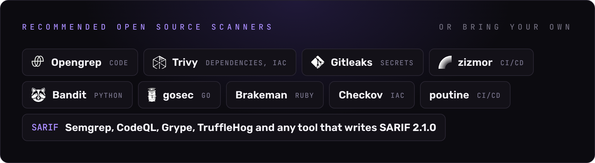

<p align="center">
  <a href="https://cybedefend.com"></a>
</p>

<p align="center"><strong>Une commande dans votre agent de code. Un audit de sécurité complet. Chaque faille prouvée par un exploit.</strong><br>
L'alternative open source à Snyk : une AppSec agentique auto-hébergée, avec un scanner IA exécuté par votre agent de code.</p>

<p align="center">
  <a href="https://github.com/CybeDefend/cybedefend/tags"></a>
  <a href="LICENSE"></a>
  <a href="https://discord.gg/UPzm4n6SAJ"></a>
  <a href="https://www.linkedin.com/company/101144768"></a>
</p>

<p align="center"><a href="#quick-start">Install</a> &bull; <a href="deploy/community/README.md">Docs</a> &bull; <a href="https://cybedefend.com">Website</a> &bull; <a href="https://discord.gg/UPzm4n6SAJ">Discord</a></p>

<p align="center"><a href="README.md">English</a> &bull; <a href="README.fr.md">Français</a> &bull; <a href="README.zh-CN.md">中文</a> &bull; <a href="README.ja.md">日本語</a> &bull; <a href="README.ko.md">한국어</a> &bull; <a href="README.es.md">Español</a> &bull; <a href="README.pt-BR.md">Português</a></p>

> [!NOTE]
> Lancement sur Product Hunt le 4 décembre 2026. Venez en discuter avec nous sur [Discord](https://discord.gg/UPzm4n6SAJ).

**① Un audit complet en une commande.**
Tapez `/cybedefend` dans votre agent de code. Les scanners open source tournent, le scanner IA traque ce qu'ils ne voient pas, et votre agent juge chaque résultat au regard de votre code. Il répond **SHIP**, ou **NOT YET** avec ce qui bloque et le correctif pour chaque point.

**② Chaque faille prouvée.**
Le scanner IA écrit chaque exploit sous forme de test dans la suite de tests de votre dépôt. Un résultat est un fait, pas une supposition.

**③ Derrière, toute une plateforme AppSec open source.**
Vous l'hébergez : un dashboard pour votre équipe, des politiques qui décident de ce qui bloque, des intégrations avec votre stack et un serveur MCP que lit votre agent de code.

<p align="center"></p>

<p align="center">S'il prouve une faille dans votre code, une étoile aide d'autres développeurs à le trouver.</p>

<br>

<a id="quick-start"></a>
# Démarrage rapide

```bash
npx skills add CybeDefend/cybedefend -g
```

Ouvrez votre agent de code dans le dépôt à auditer, puis tapez :

```text
/cybedefend
```

L'installation s'arrête là. Aucun jeton à copier, aucun fichier à modifier, aucun serveur à démarrer.

- **Fonctionne avec** Claude Code, Codex, Cursor et tout agent de code qui lit les skills.
- **Nécessite** Docker en cours d'exécution, avec Docker Compose 2.24.4 ou plus récent, environ 4 GB de mémoire, git et Node.js.
- **Répond** **SHIP**, ou **NOT YET** avec ce qui bloque et le correctif pour chaque point.

<details>
<summary><b>Ce que la première exécution met en place toute seule</b></summary>

<br>

Elle ne demande rien :

1. Elle démarre le dashboard sur votre machine avec Docker Compose, sur le premier port libre à partir de 8080, lié à `127.0.0.1`. La première fois, Docker télécharge les images (environ 6 GB, quelques minutes). Les exécutions suivantes prennent quelques secondes et ne changent rien.
2. Elle crée le premier administrateur et un jeton d'accès personnel, enregistré dans `~/.cybedefend/appsec/credentials.json` (mode 600, jamais affiché).
3. Elle crée le projet de votre dépôt, et une politique par défaut quand votre équipe n'en a pas : les résultats critiques et élevés bloquent, tout secret dans le code aussi, les résultats moyens donnent un avertissement.
4. Elle connecte le serveur MCP à Claude Code. Pour un autre agent, elle affiche l'adresse à ajouter.

Quand les images publiées ne peuvent pas être téléchargées, la première exécution les construit à partir des sources et le dit (15 à 30 minutes, une seule fois).

</details>

<br>

# Comment ça marche

Une commande. Cinq étapes. Un verdict.

| Étape | Ce qui se passe |
|---|---|
| **1.&nbsp;Scanners** | Les scanners open source trouvent les motifs connus. |
| **2.&nbsp;Scanner&nbsp;IA** | Votre agent de code cartographie chaque point d'entrée, écrit ce que le code ne doit jamais permettre, traque la logique métier, les droits d'accès, les tenants, l'identité et les situations de concurrence, et prouve chaque faille par un exploit écrit sous forme de test dans votre propre suite. |
| **3.&nbsp;Triage** | Votre agent juge chaque résultat des scanners au regard de votre code. |
| **4.&nbsp;Dashboard** | Vos politiques rendent le verdict : **SHIP** ou **NOT YET**. |
| **5.&nbsp;Rapport** | Ce qui bloque, et le correctif pour chaque point. |

**C'est votre propre agent de code qui exécute le scanner IA.** Aucun modèle supplémentaire, aucune clé d'API.

**Sans danger à l'exécution.** L'audit ne modifie aucun code applicatif. Le scanner IA n'envoie aucune requête à un système déployé ni à un tiers, et n'utilise ni identifiants réels ni données personnelles.

<details>
<summary><b>Ce que fait le scanner IA, exactement</b></summary>

<br>

Il liste chaque point d'entrée du code (routes, consommateurs de messages, tâches planifiées, webhooks), une ligne pour chacun, avec qui peut l'appeler et le contrôle qui l'impose. Il écrit les garanties du code en phrases simples : un membre ne voit que les documents de sa propre équipe, un virement ne fait jamais passer un solde sous zéro.

La première exécution passe en revue tout le dépôt. Les suivantes passent en revue ce que la branche a modifié et les points d'entrée qui l'atteignent. Chaque ligne de ce périmètre est passée en revue, rôle par rôle.

Une piste devient un résultat quand un test écrit dans votre propre framework de test échoue pour la raison qu'elle avance. Toute autre piste part au dashboard comme une note qui ne peut pas bloquer.

Le rapport compte les points d'entrée passés en revue, les résultats retenus et les résultats écartés, avec les raisons.

</details>

<details>
<summary><b>Ce qui bloque, exactement</b></summary>

<br>

Les politiques s'appliquent à une organisation, une équipe ou un projet. Elles sont écrites en YAML, que vous importez et exportez. Chaque règle cible des résultats selon la sévérité, le score CVSS, la CWE, la catégorie OWASP, le type de scanner, l'ancienneté ou la branche, seuls ou combinés.

Une règle Block rend le verdict NOT YET, et `/cybedefend` se termine avec le code 1. Une règle Warn enregistre la violation. Les politiques jugent de nouveau à la fin de chaque scan et de chaque import.

</details>

<br>

# La plateforme

Derrière la commande, une plateforme AppSec open source complète. Vous l'hébergez, votre équipe y travaille, et votre agent de code la lit à travers le serveur MCP.

### Toute l'organisation en une vue

<p align="center"></p>

### Chaque résultat, branche par branche

<p align="center"></p>

### Vos politiques décident de ce qui bloque

<p align="center"></p>

<details>
<summary><b>Tout ce que contient l'édition open source</b></summary>

<br>

| Fonctionnalité | Ce que vous obtenez |
|---|---|
| **Des résultats qui suivent le code** | Résolus quand le scan est propre, rouverts quand ils reviennent |
| **Politiques de sécurité** | Des règles Block et Warn, en YAML |
| **Organisations, équipes, rôles** | Quatre rôles d'organisation, quatre rôles d'équipe |
| **Score de risque par projet** | Un niveau CybeRisk, les plus risqués en premier |
| **Rapports** | OWASP Top 10 et CWE Top 25, en PDF, HTML ou JSON |
| **Serveur MCP** | 21 outils pour votre agent de code |
| **Jetons d'accès personnels** | Pour votre CI, l'API d'import et le serveur MCP |
| **Auto-hébergé** | Docker Compose et PostgreSQL 18, sur vos serveurs |
| **Aucune limite de sièges, aucune télémétrie** | Aucun quota de scans, des rapports conservés sans expiration |

</details>

<br>

# Intégrations

Branché sur votre stack.

<p align="center"></p>

<details>
<summary><b>Ce que fait chaque intégration</b></summary>

<br>

| Intégration | Ce qu'elle fait |
|---|---|
| **GitHub** | Une GitHub App que vous créez. Des dépôts liés, des issues ouvertes à la fin d'un scan et fermées quand tous leurs résultats sont résolus, un scan à chaque push avec un cluster. |
| **GitLab** | GitLab.com ou votre propre GitLab, avec les mêmes fonctionnalités que GitHub. |
| **Jira et Linear** | Des tickets à partir d'un résultat, ou à la fin de chaque scan. |
| **Slack et e-mail** | Un message quand un scan se termine, chaque semaine et chaque mois. |
| **GitHub Actions et GitLab CI** | Les scanners sur chaque pull request, les résultats dans votre dashboard. Toute autre CI les lance avec `docker run`. |
| **Agents de code** | Deux skills pour tout agent qui lit les skills, et un serveur MCP avec 21 outils. |
| **Tout autre scanner** | Tout fichier SARIF 2.1.0 par l'API d'import ou `/cybedefend import`, avec un SBOM CycloneDX pour la liste complète des paquets. |
| **Docker Compose et Kubernetes** | La plateforme tourne avec Docker Compose. Connectez un cluster Kubernetes et elle lance les scans elle-même, un pod par scanner. |

Chaque intégration s'active avec ses paramètres : [deploy/community/README.md](deploy/community/README.md) les liste, avec l'adresse de callback de chaque fournisseur.

</details>

<br>

# Commandes

Tapez `/cybedefend` avant chaque déploiement. Les autres commandes en exécutent une étape, ou vont plus loin.

| Commande | Ce qu'elle fait |
|---|---|
| `/cybedefend` | L'audit complet : tout le dépôt à la première exécution, ce que la branche a modifié ensuite. |
| `/cybedefend deep` | L'audit lourd, pour une release : un verdict sur chaque fonction. |
| `/cybedefend fix` | Corrige ce qui bloque, chaque correctif prouvé par un test. |
| `/cybedefend audit` | Tout le dépôt de nouveau, puis deux agents qui n'ont pas écrit la revue la vérifient. |
| `/cybedefend scan` | Les scanners et le verdict. `--quick` lance les scanners principaux. |
| `/cybedefend triage` | Chaque résultat des scanners jugé au regard de votre code. |
| `/cybedefend live` | Rejoue les failles prouvées sur votre application, sur votre machine, avec des données jetables. |
| `/cybedefend import <file>` | Envoie le fichier SARIF d'un autre outil vers votre dashboard. |
| `/cybedefend report` | Le rapport de la dernière exécution. |
| `/cybedefend open` | Ouvre le dashboard et la page d'audit de la dernière exécution. |
| `/cybedefend replay` | Rejoue la page de la dernière exécution, telle qu'elle s'est déroulée. |
| `/cybedefend setup` | La mise en place seule. |
| `/cybedefend-setup` | Le second skill : un serveur, HTTPS, ou des scans sur un cluster Kubernetes. |

<br>

# Scanners

Tous les scanners dont une équipe a besoin. La stack de votre dépôt décide lesquels tournent.

<p align="center"></p>

Ce sont les scanners que nous recommandons, et tout autre scanner fonctionne.

| Domaine | Outils, par exemple |
|---|---|
| **Code** | Opengrep, Bandit, gosec, Brakeman<br><sub>Les fichiers source</sub> |
| **Dépendances** | Trivy, avec la liste complète des paquets (SBOM)<br><sub>Un lockfile ou des versions épinglées</sub> |
| **Secrets** | Gitleaks<br><sub>Les fichiers que git voit</sub> |
| **Infrastructure as code** | Trivy, Checkov<br><sub>Terraform, Kubernetes, Helm, Dockerfile, CloudFormation</sub> |
| **CI/CD** | zizmor, poutine<br><sub>GitHub Actions, GitLab CI, Azure Pipelines, Tekton</sub> |
| **Conteneurs** | Trivy<br><sub>Une image que vous nommez</sub> |

- **Open source, à votre choix**, une image par outil dans [`CybeDefend/cybedefend-scanners`](https://github.com/CybeDefend/cybedefend-scanners).
- **Rien d'installé sur votre machine.**
- **Plus tout scanner qui écrit du SARIF**, avec `/cybedefend import <file>`.

<details>
<summary><b>Les outils que vous gardez, via SARIF</b></summary>

<br>

| Domaine | Outils que vous gardez |
|---|---|
| **Code** | Semgrep, CodeQL, SonarQube, Snyk Code, règles de sécurité ESLint |
| **Dépendances** | Grype, osv-scanner, Snyk Open Source, OWASP Dependency-Check |
| **Infrastructure as code** | KICS, tfsec, Terrascan, Kubescape |
| **Secrets et CI/CD** | TruffleHog, detect-secrets, actionlint |
| **Tout le reste** | Tout outil qui écrit du SARIF 2.1.0 |

</details>

<br>

# Prêt pour l'audit, toute l'année

Les preuves que demandent les auditeurs SOC 2 et ISO 27001, conservées pendant que vous travaillez.

| Votre auditeur demande | CybeDefend conserve |
|---|---|
| Des vulnérabilités traitées à temps<br><sub>ISO 27001 A.8.8, SOC 2 CC7.1</sub> | Chaque résultat avec sa date, sa sévérité et l'historique de son statut |
| Développement et tests sécurisés<br><sub>ISO 27001 A.8.28, A.8.29</sub> | Un scan sur chaque pull request, et chaque faille prouvée par le scanner IA avec son test |
| Gestion des changements<br><sub>ISO 27001 A.8.25, SOC 2 CC8.1</sub> | Vos politiques, jugées à chaque scan et chaque import, chaque violation enregistrée |
| Preuves d'audit | Des rapports OWASP Top 10 et CWE Top 25 en PDF |

<br>

# Documentation

- **Guide d'auto-hébergement** : [deploy/community/README.md](deploy/community/README.md), avec HTTPS et les reverse proxies, la clé secrète, les intégrations, les mises à jour, les sauvegardes et la vérification d'une image.
- **Les scanners dans votre CI** : [CybeDefend/cybedefend-scanners](https://github.com/CybeDefend/cybedefend-scanners).
- **Build et tests** : [CONTRIBUTING.md](CONTRIBUTING.md).
- **Signaler une vulnérabilité** : [SECURITY.md](SECURITY.md).

## Dans votre CI

Les images de scanners de [CybeDefend/cybedefend-scanners](https://github.com/CybeDefend/cybedefend-scanners) tournent sur chaque pull request et envoient leurs résultats à votre dashboard. Le workflow complet, l'épinglage par commit et toutes les options y sont documentés.

Il vous faut une instance que vos runners peuvent joindre, un projet, et le jeton d'accès personnel d'un utilisateur autorisé à y lancer des scans.

<details>
<summary><b>GitHub Actions</b>, une étape par scanner</summary>

<br>

```yaml
- uses: CybeDefend/cybedefend-scanners@v1.0.0
  with:
    scanner: opengrep
    api-url: ${{ vars.CYBEDEFEND_API_URL }}
    project-id: ${{ vars.CYBEDEFEND_PROJECT_ID }}
    token: ${{ secrets.CYBEDEFEND_TOKEN }}
```

</details>

<details>
<summary><b>GitLab CI</b>, un job par scanner</summary>

<br>

```yaml
include:
  - remote: https://raw.githubusercontent.com/CybeDefend/cybedefend-scanners/v1.0.0/templates/gitlab/cybedefend-scanners.gitlab-ci.yml

sast:
  extends: .cybedefend-sast
```

</details>

<details>
<summary><b>Toute autre CI</b>, avec <code>docker run</code> ou la route d'import</summary>

<br>

Lancez une image de scanner par `docker run` avec `--upload`, ou envoyez le SARIF de n'importe quel outil à la route d'import avec un jeton d'accès personnel :

```bash
curl -H "Authorization: Bearer cdp_…" \
  -F file=@results.sarif -F type=sast -F branch=main \
  "$CYBEDEFEND_PUBLIC_URL/api/project/<projectId>/scan/import/start"
```

`type` vaut `sast`, `iac`, `secret`, `cicd`, `sca` ou `container`.

</details>

## Sur un serveur, ou sur un cluster Kubernetes

```text
/cybedefend-setup
```

Le skill de mise en place installe l'instance avec vous. Il est arrivé avec le même `npx skills add`.

<details>
<summary><b>Ce que fait le skill de mise en place</b></summary>

<br>

Il vérifie Docker et les clusters Kubernetes qu'il voit, prend une valeur par défaut pour chaque choix, demande ce qu'il ne peut pas décider (des scans sur l'un de ces clusters, le domaine d'un serveur), confirme une fois, puis écrit les paramètres, connecte le cluster et démarre la stack.

Avec un cluster connecté, l'instance démarre un pod par scanner dans un namespace qui lui est propre : **Start scan** apparaît à côté de **Import results**, une archive ZIP téléversée est scannée, et un projet lié à GitHub ou GitLab peut être scanné à chaque push.

</details>

<details>
<summary><b>Installer à la main</b></summary>

<br>

Il vous faut Docker Compose 2.24.4 ou plus récent et environ 4 GB de RAM. La stack apporte son propre PostgreSQL 18.

```bash
git clone https://github.com/CybeDefend/cybedefend && cd cybedefend/deploy/community

# The master key: at least 32 random bytes, in a file readable by you alone.
(umask 077 && openssl rand -base64 32 > secret-key)
cp .env.example .env

# In .env, set the two required values:
#   CYBEDEFEND_SETUP_TOKEN  a long random string, for example: openssl rand -hex 32
#   CYBEDEFEND_PUBLIC_URL   the address users open, http://localhost:8080 by default
docker compose up -d
```

Ouvrez le dashboard à l'adresse `CYBEDEFEND_PUBLIC_URL`, puis saisissez `CYBEDEFEND_SETUP_TOKEN` pour créer le premier administrateur.

Gardez une sauvegarde de la clé maître (`secret-key`) et ne la changez jamais : elle chiffre les identifiants des intégrations, les secrets trouvés et les clés de connexion.

</details>

<br>

# L’équipe fondatrice

<table align="center">
  <tr>
    <td align="center" valign="top" width="200">
      <br>
      <b>Julien Zammit</b><br>
      <sub>Cofondateur et CEO</sub><br>
      <a href="https://x.com/JulienZammit1">X</a> &bull; <a href="https://www.linkedin.com/in/julienzammit">LinkedIn</a>
    </td>
    <td align="center" valign="top" width="200">
      <br>
      <b>Florentin Ledy</b><br>
      <sub>Cofondateur et CPTO</sub><br>
      <a href="https://www.linkedin.com/in/florentin-ledy">LinkedIn</a> &bull; <a href="https://github.com/FlorentinLedy">GitHub</a>
    </td>
    <td align="center" valign="top" width="200">
      <br>
      <b>Axel Paulin</b><br>
      <sub>Cofondateur et COO</sub><br>
      <a href="https://www.linkedin.com/in/axel-paulin">LinkedIn</a>
    </td>
  </tr>
</table>

<br>

# Contribuer

Les issues et les pull requests sont les bienvenues. Lisez d'abord [CONTRIBUTING.md](CONTRIBUTING.md).
Pour signaler une vulnérabilité, suivez [SECURITY.md](SECURITY.md).
Pour discuter avec nous, rejoignez [Discord](https://discord.gg/UPzm4n6SAJ).

## Licence

Open source sous la GNU Affero General Public License v3 (AGPL-3.0-only, voir LICENSE). Copyright (C) 2026 CybeDefend SAS. La clause réseau (section 13 de l'AGPL) : si vous le modifiez et laissez des utilisateurs interagir avec lui à travers un réseau, vous devez leur proposer vos sources modifiées. Cette édition n'envoie aucune télémétrie : rien ne sort de votre instance vers CybeDefend.

[LICENSE](LICENSE) &bull; [THIRD_PARTY_NOTICES.md](THIRD_PARTY_NOTICES.md) &bull; [TRADEMARKS.md](TRADEMARKS.md) &bull; [CONTRIBUTING.md](CONTRIBUTING.md) &bull; [SECURITY.md](SECURITY.md)

<br>

<p align="center"><sub>AGPL-3.0-only. Les scanners conservent leurs propres licences. Conçu par <a href="https://cybedefend.com">CybeDefend</a>.<br>Snyk et GitHub sont des marques de leurs propriétaires. CybeDefend n'est pas affilié à eux.</sub></p>
