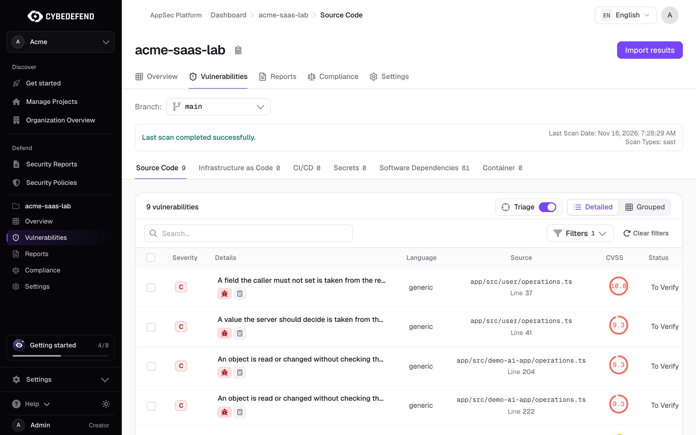

<p align="center">
  <a href="https://cybedefend.com"></a>
</p>

<p align="center"><strong>코딩 에이전트에서 명령어 하나. 전체 보안 감사. 모든 취약점을 익스플로잇으로 증명합니다.</strong><br>
Snyk의 오픈소스 대안: 직접 호스팅하는 에이전틱 AppSec, 그리고 여러분의 코딩 에이전트가 실행하는 AI 스캐너.</p>

<p align="center">
  <a href="https://github.com/CybeDefend/cybedefend/stargazers"></a>
  <a href="https://github.com/CybeDefend/cybedefend/tags"></a>
  <a href="LICENSE"></a>
  <a href="https://discord.gg/UPzm4n6SAJ"></a>
  <a href="https://www.linkedin.com/company/101144768"></a>
</p>

<p align="center"><a href="#quick-start">Install</a> &bull; <a href="deploy/community/README.md">Docs</a> &bull; <a href="https://cybedefend.com">Website</a> &bull; <a href="https://discord.gg/UPzm4n6SAJ">Discord</a></p>

<p align="center"><a href="README.md">English</a> &bull; <a href="README.fr.md">Français</a> &bull; <a href="README.zh-CN.md">中文</a> &bull; <a href="README.ja.md">日本語</a> &bull; <a href="README.ko.md">한국어</a> &bull; <a href="README.es.md">Español</a> &bull; <a href="README.pt-BR.md">Português</a></p>

> [!NOTE]
> star 하나가 다른 개발자들이 이 저장소를 찾는 계기가 됩니다. 2026년 12월 4일 Product Hunt에 출시합니다. [Discord](https://discord.gg/UPzm4n6SAJ)에서 함께 이야기해요.

**① 명령어 하나로 전체 감사.**
코딩 에이전트에 `/cybedefend`를 입력하세요. 오픈소스 스캐너가 실행되고, AI 스캐너가 스캐너로는 보이지 않는 것을 찾아내며, 에이전트가 모든 발견 항목을 여러분의 코드에 비추어 판단합니다. 답은 **SHIP**, 또는 **NOT YET**과 함께 무엇이 막고 있는지와 각각의 수정 방법입니다.

**② 모든 취약점을 증명합니다.**
AI 스캐너는 각 익스플로잇을 저장소의 기존 테스트 스위트 안에 테스트로 작성합니다. 발견 항목은 추측이 아니라 사실입니다.

**③ 그 뒤에는 오픈소스 AppSec 플랫폼 전체가 있습니다.**
호스팅은 여러분이 합니다: 팀을 위한 dashboard, 무엇을 막을지 결정하는 정책, 사용 중인 스택과의 연동, 그리고 코딩 에이전트가 읽는 MCP 서버.

<p align="center"></p>

<p align="center">여러분의 코드에서 취약점을 증명했다면, star 하나가 다른 개발자들이 이 프로젝트를 찾는 데 도움이 됩니다.</p>

<br>

<a id="quick-start"></a>
# 빠른 시작

```bash
npx skills add CybeDefend/cybedefend -g
```

감사할 저장소에서 코딩 에이전트를 열고 다음을 입력하세요:

```text
/cybedefend
```

설치는 이것이 전부입니다. 복사할 토큰도, 수정할 파일도, 띄울 서버도 없습니다.

- **지원 환경**: Claude Code, Codex, Cursor, 그리고 skill을 읽는 모든 코딩 에이전트.
- **요구 사항**: 실행 중인 Docker와 Docker Compose 2.24.4 이상, 약 4 GB의 메모리, git, Node.js.
- **결과**: **SHIP**, 또는 **NOT YET**과 함께 무엇이 막고 있는지와 각각의 수정 방법.

<details>
<summary><b>첫 실행이 스스로 설정하는 것</b></summary>

<br>

아무것도 묻지 않습니다:

1. Docker Compose로 여러분의 머신에 dashboard를 띄웁니다. 8080부터 처음으로 비어 있는 포트를 사용하며 `127.0.0.1`에 바인딩합니다. 처음에는 Docker가 이미지를 내려받습니다(약 6 GB, 몇 분). 이후 실행은 몇 초면 끝나고 아무것도 바꾸지 않습니다.
2. 첫 번째 관리자와 개인 액세스 토큰을 만들어 `~/.cybedefend/appsec/credentials.json`에 저장합니다(모드 600, 화면에 출력하지 않음).
3. 저장소의 프로젝트를 만들고, 팀에 정책이 없으면 기본 정책도 만듭니다: critical과 high 발견 항목은 차단하고, 코드 안의 모든 시크릿도 차단하며, medium 발견 항목은 경고합니다.
4. MCP 서버를 Claude Code에 연결합니다. 다른 에이전트라면 추가할 주소를 출력합니다.

배포된 이미지를 내려받을 수 없으면 첫 실행이 소스에서 이미지를 빌드하고 그 사실을 알려 줍니다(15~30분, 한 번만).

</details>

<br>

# 동작 방식

명령어 하나. 다섯 단계. 판정 하나.

| 단계 | 하는 일 |
|---|---|
| **1.&nbsp;스캐너** | 오픈소스 스캐너가 알려진 패턴을 찾습니다. |
| **2.&nbsp;AI&nbsp;스캐너** | 코딩 에이전트가 모든 진입점을 매핑하고, 코드가 절대 허용해서는 안 되는 것을 적어 두고, 비즈니스 로직, 접근 권한, 테넌트, 신원, 경쟁 상태를 파고들어, 각 취약점을 여러분의 테스트 스위트 안에 테스트로 작성한 익스플로잇으로 증명합니다. |
| **3.&nbsp;트리아지** | 에이전트가 스캐너의 모든 발견 항목을 여러분의 코드에 비추어 판단합니다. |
| **4.&nbsp;Dashboard** | 여러분의 정책이 판정을 내립니다: **SHIP** 또는 **NOT YET**. |
| **5.&nbsp;리포트** | 무엇이 막고 있는지, 그리고 각각의 수정 방법. |

**AI 스캐너는 여러분의 코딩 에이전트가 실행합니다.** 추가 모델도, API 키도 필요 없습니다.

**안전하게 실행할 수 있습니다.** 감사는 애플리케이션 코드를 전혀 바꾸지 않습니다. AI 스캐너는 배포된 시스템이나 제3자에게 요청을 보내지 않으며, 실제 자격 증명이나 개인 정보를 사용하지 않습니다.

<details>
<summary><b>AI 스캐너가 정확히 하는 일</b></summary>

<br>

코드의 모든 진입점(라우트, 메시지 컨슈머, 예약 작업, 웹훅)을 한 줄에 하나씩, 누가 호출할 수 있는지와 그것을 강제하는 검사와 함께 나열합니다. 그리고 코드의 보장 사항을 평범한 문장으로 적습니다: 멤버는 자기 팀의 문서만 볼 수 있다, 이체는 잔액을 0 아래로 떨어뜨리지 않는다.

첫 실행은 저장소 전체를 검토합니다. 이후 실행은 브랜치가 바꾼 부분과 거기에 닿는 진입점을 검토합니다. 그 범위의 모든 줄을 역할별로 검토합니다.

단서는 여러분의 테스트 프레임워크로 작성한 테스트가 그 단서가 주장하는 이유로 실패할 때 발견 항목이 됩니다. 나머지 단서는 모두 차단할 수 없는 노트로 dashboard에 올라갑니다.

리포트는 검토한 진입점, 채택한 발견 항목, 제외한 발견 항목의 수를 이유와 함께 보여 줍니다.

</details>

<details>
<summary><b>정확히 무엇이 막는가</b></summary>

<br>

정책은 조직, 팀 또는 프로젝트에 적용됩니다. YAML로 작성하며 가져오기와 내보내기가 됩니다. 각 규칙은 심각도, CVSS 점수, CWE, OWASP 카테고리, 스캐너 유형, 경과 기간 또는 브랜치를 기준으로, 단독으로 또는 조합해서 발견 항목과 매칭합니다.

Block 규칙은 판정을 NOT YET으로 만들고, `/cybedefend`는 코드 1로 종료합니다. Warn 규칙은 위반을 기록합니다. 정책은 모든 스캔과 모든 가져오기가 끝날 때마다 다시 판정합니다.

</details>

<br>

# 플랫폼

명령어 뒤에는 완전한 오픈소스 AppSec 플랫폼이 있습니다. 여러분이 호스팅하고, 팀이 그 안에서 일하며, 코딩 에이전트가 MCP 서버를 통해 읽습니다.

### 조직 전체를 한 화면에서

<p align="center"></p>

### 모든 발견 항목을 브랜치별로

<p align="center"></p>

### 무엇을 막을지는 여러분의 정책이 결정합니다

<p align="center"></p>

<details>
<summary><b>오픈소스 에디션에 포함된 모든 것</b></summary>

<br>

| 기능 | 제공되는 것 |
|---|---|
| **코드를 따라가는 발견 항목** | 스캔이 깨끗하면 해결 처리되고, 다시 나타나면 다시 열립니다 |
| **보안 정책** | YAML로 작성하는 Block 및 Warn 규칙 |
| **조직, 팀, 역할** | 조직 역할 네 가지, 팀 역할 네 가지 |
| **프로젝트별 위험 점수** | CybeRisk 등급, 가장 위험한 것부터 |
| **리포트** | OWASP Top 10과 CWE Top 25, PDF, HTML 또는 JSON |
| **MCP 서버** | 코딩 에이전트를 위한 21 tools |
| **개인 액세스 토큰** | CI, 가져오기 API, MCP 서버용 |
| **셀프 호스팅** | 여러분의 서버에서 Docker Compose와 PostgreSQL 18으로 |
| **시트 제한 없음, 텔레메트리 없음** | 스캔 할당량 없음, 리포트는 만료 없이 보관 |

</details>

<br>

# 연동

여러분의 스택에 바로 연결됩니다.

<p align="center"></p>

<details>
<summary><b>각 연동이 하는 일</b></summary>

<br>

| 연동 | 하는 일 |
|---|---|
| **GitHub** | 여러분이 직접 만드는 GitHub App. 연결된 저장소, 스캔이 끝나면 열리고 그 안의 모든 발견 항목이 해결되면 닫히는 이슈, 클러스터가 있으면 push마다 스캔. |
| **GitLab** | GitLab.com 또는 자체 GitLab, GitHub과 같은 기능. |
| **Jira와 Linear** | 발견 항목에서, 또는 각 스캔이 끝날 때 티켓 생성. |
| **Slack과 이메일** | 스캔이 완료될 때, 그리고 매주와 매월 메시지. |
| **GitHub Actions와 GitLab CI** | 모든 pull request에서 스캐너 실행, 결과는 여러분의 dashboard로. 다른 CI는 `docker run`으로 실행합니다. |
| **코딩 에이전트** | skill을 읽는 모든 에이전트를 위한 skill 두 개, 그리고 21 tools를 갖춘 MCP 서버. |
| **그 밖의 모든 스캐너** | 가져오기 API 또는 `/cybedefend import`로 모든 SARIF 2.1.0 파일을, 전체 패키지 목록을 위한 CycloneDX SBOM과 함께. |
| **Docker Compose와 Kubernetes** | 플랫폼은 Docker Compose로 실행됩니다. Kubernetes 클러스터를 연결하면 플랫폼이 직접 스캔을 실행하며, 스캐너마다 pod 하나를 사용합니다. |

각 연동은 해당 설정으로 켭니다: [deploy/community/README.md](deploy/community/README.md)에 설정 목록과 각 제공자의 콜백 주소가 있습니다.

</details>

<br>

# 명령어

배포할 때마다 그 전에 `/cybedefend`를 입력하세요. 다른 명령어는 그중 한 단계만 실행하거나 더 깊이 들어갑니다.

| 명령어 | 하는 일 |
|---|---|
| `/cybedefend` | 전체 감사: 첫 실행에서는 저장소 전체, 그 뒤로는 브랜치가 바꾼 부분. |
| `/cybedefend deep` | 릴리스를 위한 정밀 감사: 모든 함수에 대한 판정. |
| `/cybedefend fix` | 막고 있는 것을 수정하고, 각 수정을 테스트로 증명합니다. |
| `/cybedefend audit` | 저장소 전체를 다시 검토한 뒤, 그 검토를 작성하지 않은 에이전트 두 개가 확인합니다. |
| `/cybedefend scan` | 스캐너와 판정. `--quick`은 핵심 스캐너만 실행합니다. |
| `/cybedefend triage` | 스캐너의 모든 발견 항목을 여러분의 코드에 비추어 판단합니다. |
| `/cybedefend live` | 증명된 취약점을 여러분의 머신에서, 일회용 데이터로, 여러분의 애플리케이션에 재현합니다. |
| `/cybedefend import <file>` | 다른 도구의 SARIF 파일을 여러분의 dashboard로 보냅니다. |
| `/cybedefend report` | 마지막 실행의 리포트. |
| `/cybedefend open` | dashboard와 마지막 실행의 감사 페이지를 엽니다. |
| `/cybedefend replay` | 마지막 실행의 페이지를 일어난 그대로 다시 재생합니다. |
| `/cybedefend setup` | 설정만 실행합니다. |
| `/cybedefend-setup` | 두 번째 skill: 서버, HTTPS, 또는 Kubernetes 클러스터에서의 스캔. |

<br>

# 스캐너

팀에 필요한 모든 스캐너. 어떤 것이 실행될지는 저장소의 스택이 결정합니다.

<p align="center"></p>

아래는 저희가 권장하는 스캐너이며, 다른 스캐너도 모두 사용할 수 있습니다.

| 영역 | 도구 예시 |
|---|---|
| **코드** | Opengrep, Bandit, gosec, Brakeman<br><sub>소스 파일</sub> |
| **의존성** | Trivy, 전체 패키지 목록(SBOM) 포함<br><sub>lockfile 또는 고정된 버전</sub> |
| **시크릿** | Gitleaks<br><sub>git이 보는 파일</sub> |
| **코드형 인프라(IaC)** | Trivy, Checkov<br><sub>Terraform, Kubernetes, Helm, Dockerfile, CloudFormation</sub> |
| **CI/CD** | zizmor, poutine<br><sub>GitHub Actions, GitLab CI, Azure Pipelines, Tekton</sub> |
| **컨테이너** | Trivy<br><sub>여러분이 지정하는 이미지</sub> |

- **오픈소스, 선택은 여러분이**, 도구마다 이미지 하나씩 [`CybeDefend/cybedefend-scanners`](https://github.com/CybeDefend/cybedefend-scanners)에 있습니다.
- **여러분의 머신에는 아무것도 설치하지 않습니다.**
- **여기에 SARIF를 출력하는 모든 스캐너까지**, `/cybedefend import <file>`로.

<details>
<summary><b>SARIF로 그대로 쓰는 기존 도구</b></summary>

<br>

| 영역 | 그대로 쓰는 도구 |
|---|---|
| **코드** | Semgrep, CodeQL, SonarQube, Snyk Code, ESLint 보안 규칙 |
| **의존성** | Grype, osv-scanner, Snyk Open Source, OWASP Dependency-Check |
| **코드형 인프라(IaC)** | KICS, tfsec, Terrascan, Kubescape |
| **시크릿과 CI/CD** | TruffleHog, detect-secrets, actionlint |
| **그 밖의 모든 것** | SARIF 2.1.0을 출력하는 모든 도구 |

</details>

<br>

# 1년 내내 감사 대비 완료

SOC 2와 ISO 27001 심사원이 요구하는 증빙을, 여러분이 일하는 동안 보관합니다.

| 심사원이 요구하는 것 | CybeDefend가 보관하는 것 |
|---|---|
| 기한 내에 처리된 취약점<br><sub>ISO 27001 A.8.8, SOC 2 CC7.1</sub> | 모든 발견 항목과 그 날짜, 심각도, 상태 변경 이력 |
| 시큐어 코딩과 테스트<br><sub>ISO 27001 A.8.28, A.8.29</sub> | 모든 pull request에서의 스캔, 그리고 AI 스캐너가 증명한 각 취약점과 그 테스트 |
| 변경 관리<br><sub>ISO 27001 A.8.25, SOC 2 CC8.1</sub> | 모든 스캔과 가져오기에서 판정되는 여러분의 정책, 기록되는 각 위반 |
| 감사 증빙 | OWASP Top 10과 CWE Top 25 리포트(PDF) |

<br>

# 문서

- **셀프 호스팅 가이드**: [deploy/community/README.md](deploy/community/README.md). HTTPS와 리버스 프록시, 시크릿 키, 연동, 업그레이드, 백업, 이미지 검증 방법을 다룹니다.
- **CI에서 스캐너 실행**: [CybeDefend/cybedefend-scanners](https://github.com/CybeDefend/cybedefend-scanners).
- **빌드와 테스트**: [CONTRIBUTING.md](CONTRIBUTING.md).
- **취약점 제보**: [SECURITY.md](SECURITY.md).

## CI에서

[CybeDefend/cybedefend-scanners](https://github.com/CybeDefend/cybedefend-scanners)의 스캐너 이미지는 모든 pull request에서 실행되어 결과를 여러분의 dashboard로 보냅니다. 전체 워크플로, commit 기준 고정 방법, 모든 옵션은 그곳에 문서화되어 있습니다.

runner가 접근할 수 있는 인스턴스, 프로젝트, 그리고 그 프로젝트에서 스캔을 시작할 수 있는 사용자의 개인 액세스 토큰이 필요합니다.

<details>
<summary><b>GitHub Actions</b>, 스캐너마다 step 하나</summary>

<br>

```yaml
- uses: CybeDefend/cybedefend-scanners@v1.0.0
  with:
    scanner: opengrep
    api-url: ${{ vars.CYBEDEFEND_API_URL }}
    project-id: ${{ vars.CYBEDEFEND_PROJECT_ID }}
    token: ${{ secrets.CYBEDEFEND_TOKEN }}
```

</details>

<details>
<summary><b>GitLab CI</b>, 스캐너마다 job 하나</summary>

<br>

```yaml
include:
  - remote: https://raw.githubusercontent.com/CybeDefend/cybedefend-scanners/v1.0.0/templates/gitlab/cybedefend-scanners.gitlab-ci.yml

sast:
  extends: .cybedefend-sast
```

</details>

<details>
<summary><b>그 밖의 모든 CI</b>, <code>docker run</code> 또는 가져오기 라우트로</summary>

<br>

스캐너 이미지를 `--upload`와 함께 `docker run`으로 실행하거나, 개인 액세스 토큰으로 어떤 도구의 SARIF든 가져오기 라우트로 보내세요:

```bash
curl -H "Authorization: Bearer cdp_…" \
  -F file=@results.sarif -F type=sast -F branch=main \
  "$CYBEDEFEND_PUBLIC_URL/api/project/<projectId>/scan/import/start"
```

`type`은 `sast`, `iac`, `secret`, `cicd`, `sca`, `container` 중 하나입니다.

</details>

## 서버 또는 Kubernetes 클러스터에서

```text
/cybedefend-setup
```

setup skill이 여러분과 함께 인스턴스를 설치합니다. 같은 `npx skills add`로 함께 설치되어 있습니다.

<details>
<summary><b>setup skill이 하는 일</b></summary>

<br>

Docker와 접근 가능한 Kubernetes 클러스터를 확인하고, 각 선택지마다 기본값을 정하고, 스스로 결정할 수 없는 것(그 클러스터 중 하나에서의 스캔, 서버의 도메인)은 물어보고, 한 번 확인받은 다음 설정을 기록하고 클러스터를 연결하고 스택을 시작합니다.

클러스터가 연결되면 인스턴스는 전용 네임스페이스에서 스캐너마다 pod 하나를 띄웁니다: **Import results** 옆에 **Start scan**이 나타나고, 업로드한 ZIP 아카이브가 스캔되며, GitHub 또는 GitLab에 연결된 프로젝트는 push마다 스캔할 수 있습니다.

</details>

<details>
<summary><b>수동 설치</b></summary>

<br>

Docker Compose 2.24.4 이상과 약 4 GB의 RAM이 필요합니다. 스택에는 자체 PostgreSQL 18이 포함되어 있습니다.

```bash
git clone https://github.com/CybeDefend/cybedefend && cd cybedefend/deploy/community

# The master key: at least 32 random bytes, in a file readable by you alone.
(umask 077 && openssl rand -base64 32 > secret-key)
cp .env.example .env

# In .env, set the two required values:
#   CYBEDEFEND_SETUP_TOKEN  a long random string, for example: openssl rand -hex 32
#   CYBEDEFEND_PUBLIC_URL   the address users open, http://localhost:8080 by default
docker compose up -d
```

`CYBEDEFEND_PUBLIC_URL`에서 dashboard를 열고 `CYBEDEFEND_SETUP_TOKEN`을 입력해 첫 번째 관리자를 만드세요.

마스터 키(`secret-key`)는 백업해 두고 절대 바꾸지 마세요: 연동 자격 증명, 시크릿 발견 항목, 로그인 키를 암호화하는 키입니다.

</details>

<br>

# 창업 팀

<table align="center">
  <tr>
    <td align="center" valign="top" width="200">
      <br>
      <b>Julien Zammit</b><br>
      <sub>공동 창업자 겸 CEO</sub><br>
      <a href="https://x.com/JulienZammit1">X</a> &bull; <a href="https://www.linkedin.com/in/julienzammit">LinkedIn</a>
    </td>
    <td align="center" valign="top" width="200">
      <br>
      <b>Florentin Ledy</b><br>
      <sub>공동 창업자 겸 CPTO</sub><br>
      <a href="https://www.linkedin.com/in/florentin-ledy">LinkedIn</a> &bull; <a href="https://github.com/FlorentinLedy">GitHub</a>
    </td>
    <td align="center" valign="top" width="200">
      <br>
      <b>Axel Paulin</b><br>
      <sub>공동 창업자 겸 COO</sub><br>
      <a href="https://www.linkedin.com/in/axel-paulin">LinkedIn</a>
    </td>
  </tr>
</table>

<br>

<p align="center">감사에서 여러분의 코드에 문제가 발견되었다면, star 하나가 다른 개발자들이 이 프로젝트를 찾는 데 도움이 됩니다.</p>

<br>

# 기여하기

이슈와 pull request를 환영합니다. 먼저 [CONTRIBUTING.md](CONTRIBUTING.md)를 읽어 주세요.
취약점을 제보하려면 [SECURITY.md](SECURITY.md)를 따라 주세요.
저희와 이야기하려면 [Discord](https://discord.gg/UPzm4n6SAJ)에 참여하세요.

## 라이선스

GNU Affero General Public License v3(AGPL-3.0-only, LICENSE 참고)에 따른 오픈소스입니다. Copyright (C) 2026 CybeDefend SAS. 네트워크 조항(AGPL 13조): 이 소프트웨어를 수정하고 사용자가 네트워크를 통해 이용하게 한다면, 수정한 소스를 그 사용자에게 제공해야 합니다. 이 에디션은 텔레메트리를 전송하지 않습니다: 여러분의 인스턴스에서 CybeDefend로 나가는 것은 아무것도 없습니다.

[LICENSE](LICENSE) &bull; [THIRD_PARTY_NOTICES.md](THIRD_PARTY_NOTICES.md) &bull; [TRADEMARKS.md](TRADEMARKS.md) &bull; [CONTRIBUTING.md](CONTRIBUTING.md) &bull; [SECURITY.md](SECURITY.md)

<br>

<p align="center"><sub>AGPL-3.0-only. 스캐너는 각자의 라이선스를 유지합니다. <a href="https://cybedefend.com">CybeDefend</a>가 만들었습니다.<br>Snyk와 GitHub은 각 소유자의 상표입니다. CybeDefend는 이들과 제휴 관계가 없습니다.</sub></p>
