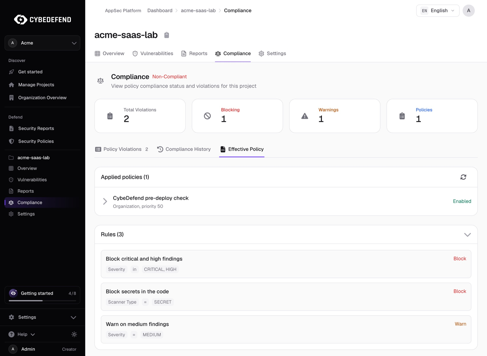

<p align="center">
  <a href="https://cybedefend.com"></a>
</p>

<p align="center"><strong>Um comando no seu agente de código. Uma auditoria de segurança completa. Cada falha provada com um exploit.</strong><br>
A alternativa open source ao Snyk: AppSec agêntico e self-hosted, com um scanner de IA que o seu agente de código executa.</p>

<p align="center">
  <a href="https://github.com/CybeDefend/cybedefend/stargazers"></a>
  <a href="https://github.com/CybeDefend/cybedefend/tags"></a>
  <a href="LICENSE"></a>
  <a href="https://discord.gg/UPzm4n6SAJ"></a>
  <a href="https://www.linkedin.com/company/101144768"></a>
</p>

<p align="center"><a href="#quick-start">Install</a> &bull; <a href="deploy/community/README.md">Docs</a> &bull; <a href="https://cybedefend.com">Website</a> &bull; <a href="https://discord.gg/UPzm4n6SAJ">Discord</a></p>

<p align="center"><a href="README.md">English</a> &bull; <a href="README.fr.md">Français</a> &bull; <a href="README.zh-CN.md">中文</a> &bull; <a href="README.ja.md">日本語</a> &bull; <a href="README.ko.md">한국어</a> &bull; <a href="README.es.md">Español</a> &bull; <a href="README.pt-BR.md">Português</a></p>

> [!NOTE]
> Uma estrela é o que faz outros desenvolvedores descobrirem este repositório. Lançamos no Product Hunt em 4 de dezembro de 2026. Venha conversar com a gente no [Discord](https://discord.gg/UPzm4n6SAJ).

**① Uma auditoria completa em um comando.**
Digite `/cybedefend` no seu agente de código. Os scanners open source rodam, o scanner de IA caça o que eles não enxergam, e o seu agente julga cada achado com base no seu código. A resposta é **SHIP**, ou **NOT YET** com o que bloqueia e a correção de cada item.

**② Cada falha provada.**
O scanner de IA escreve cada exploit como um teste na suíte de testes do seu próprio repositório. Um achado é um fato, não um palpite.

**③ Uma plataforma de AppSec open source inteira por trás.**
Você hospeda: um dashboard para o seu time, políticas que decidem o que bloqueia, integrações com a sua stack e um servidor MCP que o seu agente de código lê.

<p align="center"></p>

<p align="center">Se ele provar uma falha no seu código, uma estrela ajuda outros desenvolvedores a encontrá-lo.</p>

<br>

<a id="quick-start"></a>
# Início rápido

```bash
npx skills add CybeDefend/cybedefend -g
```

Abra o seu agente de código no repositório a auditar e digite:

```text
/cybedefend
```

Essa é a instalação inteira. Nenhum token para copiar, nenhum arquivo para editar, nenhum servidor para subir.

- **Funciona com** Claude Code, Codex, Cursor e todo agente de código que lê skills.
- **Precisa de** Docker rodando, com Docker Compose 2.24.4 ou superior, cerca de 4 GB de memória, git e Node.js.
- **Responde** **SHIP**, ou **NOT YET** com o que bloqueia e a correção de cada item.

<details>
<summary><b>O que a primeira execução configura sozinha</b></summary>

<br>

Ela não pergunta nada:

1. Sobe o dashboard na sua máquina com Docker Compose, na primeira porta livre a partir da 8080, vinculada a `127.0.0.1`. Na primeira vez, o Docker baixa as imagens (cerca de 6 GB, alguns minutos). As execuções seguintes levam segundos e não mudam nada.
2. Cria o primeiro administrador e um token de acesso pessoal, salvo em `~/.cybedefend/appsec/credentials.json` (modo 600, nunca exibido).
3. Cria o projeto do seu repositório e uma política padrão quando o seu time não tem nenhuma: achados críticos e altos bloqueiam, qualquer segredo no código também, achados médios geram aviso.
4. Conecta o servidor MCP ao Claude Code. Para outro agente, exibe o endereço a adicionar.

Quando as imagens publicadas não podem ser baixadas, a primeira execução as constrói a partir do código-fonte e avisa (15 a 30 minutos, uma única vez).

</details>

<br>

# Como funciona

Um comando. Cinco etapas. Um veredito.

| Etapa | O que acontece |
|---|---|
| **1.&nbsp;Scanners** | Os scanners open source encontram os padrões conhecidos. |
| **2.&nbsp;Scanner&nbsp;de&nbsp;IA** | O seu agente de código mapeia cada ponto de entrada, anota o que o código nunca pode permitir, caça falhas de lógica de negócio, direitos de acesso, tenants, identidade e condições de corrida, e prova cada falha com um exploit escrito como teste na sua própria suíte. |
| **3.&nbsp;Triagem** | O seu agente julga cada achado dos scanners com base no seu código. |
| **4.&nbsp;Dashboard** | As suas políticas dão o veredito: **SHIP** ou **NOT YET**. |
| **5.&nbsp;Relatório** | O que bloqueia, e a correção de cada item. |

**O seu próprio agente de código executa o scanner de IA.** Nenhum modelo extra, nenhuma chave de API.

**Seguro de rodar.** A auditoria não altera nenhum código da aplicação. O scanner de IA não envia nenhuma requisição a um sistema em produção nem a terceiros, e não usa credenciais reais nem dados pessoais.

<details>
<summary><b>O que o scanner de IA faz, exatamente</b></summary>

<br>

Ele lista cada ponto de entrada do código (rotas, consumidores de mensagens, jobs agendados, webhooks), uma linha para cada, com quem pode chamá-lo e a verificação que garante isso. Ele escreve as garantias do código em frases simples: um membro só vê os documentos do próprio time, uma transferência nunca deixa um saldo abaixo de zero.

A primeira execução revisa o repositório inteiro. As seguintes revisam o que a branch mudou e os pontos de entrada que chegam até essa mudança. Cada linha desse escopo é revisada, papel por papel.

Uma pista vira um achado quando um teste no seu próprio framework de testes falha pelo motivo que ela alega. Todas as outras pistas vão para o dashboard como uma nota que não pode bloquear.

O relatório conta os pontos de entrada revisados, os achados mantidos e os achados descartados, com os motivos.

</details>

<details>
<summary><b>O que bloqueia, exatamente</b></summary>

<br>

As políticas se aplicam a uma organização, um time ou um projeto. Elas são escritas em YAML, que você importa e exporta. Cada regra seleciona achados por severidade, score CVSS, CWE, categoria OWASP, tipo de scanner, idade ou branch, sozinhos ou combinados.

Uma regra Block torna o veredito NOT YET, e `/cybedefend` encerra com o código 1. Uma regra Warn registra a violação. As políticas julgam de novo ao fim de cada scan e de cada importação.

</details>

<br>

# A plataforma

Por trás do comando, uma plataforma de AppSec open source completa. Você hospeda, o seu time trabalha nela, e o seu agente de código a lê pelo servidor MCP.

### A organização inteira em uma só tela

<p align="center"></p>

### Cada achado, branch por branch

<p align="center"></p>

### As suas políticas decidem o que bloqueia

<p align="center"></p>

<details>
<summary><b>Tudo o que vem na edição open source</b></summary>

<br>

| Recurso | O que você tem |
|---|---|
| **Achados que acompanham o código** | Resolvidos quando o scan está limpo, reabertos quando voltam |
| **Políticas de segurança** | Regras Block e Warn, em YAML |
| **Organizações, times, papéis** | Quatro papéis de organização, quatro papéis de time |
| **Score de risco por projeto** | Um nível CybeRisk, os mais arriscados primeiro |
| **Relatórios** | OWASP Top 10 e CWE Top 25, em PDF, HTML ou JSON |
| **Servidor MCP** | 21 tools para o seu agente de código |
| **Tokens de acesso pessoal** | Para o seu CI, a API de importação e o servidor MCP |
| **Self-hosted** | Docker Compose e PostgreSQL 18, nos seus servidores |
| **Sem limite de usuários, sem telemetria** | Sem cota de scans, relatórios guardados sem expiração |

</details>

<br>

# Integrações

Conectado à sua stack.

<p align="center"></p>

<details>
<summary><b>O que cada integração faz</b></summary>

<br>

| Integração | O que ela faz |
|---|---|
| **GitHub** | Um GitHub App que você cria. Repositórios vinculados, issues abertas ao fim de um scan e fechadas quando todos os achados delas estão resolvidos, um scan a cada push com um cluster. |
| **GitLab** | GitLab.com ou o seu próprio GitLab, com os mesmos recursos do GitHub. |
| **Jira e Linear** | Tickets a partir de um achado, ou ao fim de cada scan. |
| **Slack e e-mail** | Uma mensagem quando um scan termina, toda semana e todo mês. |
| **GitHub Actions e GitLab CI** | Os scanners em cada pull request, resultados no seu dashboard. Qualquer outro CI os executa com `docker run`. |
| **Agentes de código** | Duas skills para qualquer agente que lê skills, e um servidor MCP com 21 tools. |
| **Qualquer outro scanner** | Qualquer arquivo SARIF 2.1.0 pela API de importação ou por `/cybedefend import`, com um SBOM CycloneDX para a lista completa de pacotes. |
| **Docker Compose e Kubernetes** | A plataforma roda com Docker Compose. Conecte um cluster Kubernetes e ela mesma executa os scans, um pod por scanner. |

Você ativa cada integração pelas configurações dela: [deploy/community/README.md](deploy/community/README.md) lista todas, com o endereço de callback de cada provedor.

</details>

<br>

# Comandos

Digite `/cybedefend` antes de cada deploy. Os outros comandos executam uma etapa dele, ou vão mais longe.

| Comando | O que ele faz |
|---|---|
| `/cybedefend` | A auditoria completa: o repositório inteiro na primeira execução, o que a branch mudou depois. |
| `/cybedefend deep` | A auditoria pesada, para uma release: um veredito sobre cada função. |
| `/cybedefend fix` | Corrige o que bloqueia, cada correção provada por um teste. |
| `/cybedefend audit` | O repositório inteiro de novo, e depois dois agentes que não escreveram a revisão a conferem. |
| `/cybedefend scan` | Os scanners e o veredito. `--quick` roda os scanners principais. |
| `/cybedefend triage` | Cada achado dos scanners julgado com base no seu código. |
| `/cybedefend live` | Reproduz as falhas provadas na sua aplicação, na sua máquina, com dados descartáveis. |
| `/cybedefend import <file>` | Envia o arquivo SARIF de outra ferramenta para o seu dashboard. |
| `/cybedefend report` | O relatório da última execução. |
| `/cybedefend open` | Abre o dashboard e a página de auditoria da última execução. |
| `/cybedefend replay` | Reexibe a página da última execução, como ela aconteceu. |
| `/cybedefend setup` | Só a configuração. |
| `/cybedefend-setup` | A segunda skill: um servidor, HTTPS ou scans em um cluster Kubernetes. |

<br>

# Scanners

Todos os scanners de que um time precisa. A stack do seu repositório decide quais rodam.

<p align="center"></p>

Estes são os scanners que recomendamos, e qualquer outro scanner funciona.

| Área | Ferramentas, por exemplo |
|---|---|
| **Código** | Opengrep, Bandit, gosec, Brakeman<br><sub>Os arquivos de código-fonte</sub> |
| **Dependências** | Trivy, com a lista completa de pacotes (SBOM)<br><sub>Um lockfile ou versões fixadas</sub> |
| **Segredos** | Gitleaks<br><sub>Os arquivos que o git enxerga</sub> |
| **Infraestrutura como código** | Trivy, Checkov<br><sub>Terraform, Kubernetes, Helm, Dockerfile, CloudFormation</sub> |
| **CI/CD** | zizmor, poutine<br><sub>GitHub Actions, GitLab CI, Azure Pipelines, Tekton</sub> |
| **Contêineres** | Trivy<br><sub>Uma imagem que você indica</sub> |

- **Open source, à sua escolha**, uma imagem por ferramenta em [`CybeDefend/cybedefend-scanners`](https://github.com/CybeDefend/cybedefend-scanners).
- **Nada instalado na sua máquina.**
- **E todo scanner que gera SARIF**, com `/cybedefend import <file>`.

<details>
<summary><b>As ferramentas que você mantém, via SARIF</b></summary>

<br>

| Área | Ferramentas que você mantém |
|---|---|
| **Código** | Semgrep, CodeQL, SonarQube, Snyk Code, regras de segurança do ESLint |
| **Dependências** | Grype, osv-scanner, Snyk Open Source, OWASP Dependency-Check |
| **Infraestrutura como código** | KICS, tfsec, Terrascan, Kubescape |
| **Segredos e CI/CD** | TruffleHog, detect-secrets, actionlint |
| **Qualquer outra coisa** | Qualquer ferramenta que gere SARIF 2.1.0 |

</details>

<br>

# Pronto para auditoria, o ano todo

As evidências que os auditores de SOC 2 e ISO 27001 pedem, guardadas enquanto você trabalha.

| O seu auditor pede | O CybeDefend guarda |
|---|---|
| Vulnerabilidades tratadas no prazo<br><sub>ISO 27001 A.8.8, SOC 2 CC7.1</sub> | Cada achado com sua data, sua severidade e o histórico do seu status |
| Codificação segura e testes<br><sub>ISO 27001 A.8.28, A.8.29</sub> | Um scan em cada pull request, e cada falha que o scanner de IA provou, com seu teste |
| Gestão de mudanças<br><sub>ISO 27001 A.8.25, SOC 2 CC8.1</sub> | As suas políticas, julgadas a cada scan e a cada importação, cada violação registrada |
| Evidências de auditoria | Relatórios OWASP Top 10 e CWE Top 25 em PDF |

<br>

# Documentação

- **Guia de self-hosting**: [deploy/community/README.md](deploy/community/README.md), com HTTPS e proxies reversos, a chave secreta, as integrações, atualizações, backups e como verificar uma imagem.
- **Scanners no seu CI**: [CybeDefend/cybedefend-scanners](https://github.com/CybeDefend/cybedefend-scanners).
- **Build e testes**: [CONTRIBUTING.md](CONTRIBUTING.md).
- **Reportar uma vulnerabilidade**: [SECURITY.md](SECURITY.md).

## No seu CI

As imagens de scanner de [CybeDefend/cybedefend-scanners](https://github.com/CybeDefend/cybedefend-scanners) rodam em cada pull request e enviam os resultados para o seu dashboard. O workflow completo, a fixação por commit e todas as opções estão documentados lá.

Você precisa de uma instância que os seus runners alcancem, de um projeto e de um token de acesso pessoal de um usuário que possa iniciar scans nele.

<details>
<summary><b>GitHub Actions</b>, um step por scanner</summary>

<br>

```yaml
- uses: CybeDefend/cybedefend-scanners@v1.0.0
  with:
    scanner: opengrep
    api-url: ${{ vars.CYBEDEFEND_API_URL }}
    project-id: ${{ vars.CYBEDEFEND_PROJECT_ID }}
    token: ${{ secrets.CYBEDEFEND_TOKEN }}
```

</details>

<details>
<summary><b>GitLab CI</b>, um job por scanner</summary>

<br>

```yaml
include:
  - remote: https://raw.githubusercontent.com/CybeDefend/cybedefend-scanners/v1.0.0/templates/gitlab/cybedefend-scanners.gitlab-ci.yml

sast:
  extends: .cybedefend-sast
```

</details>

<details>
<summary><b>Qualquer outro CI</b>, com <code>docker run</code> ou a rota de importação</summary>

<br>

Use `docker run` em uma imagem de scanner com `--upload`, ou envie o SARIF de qualquer ferramenta para a rota de importação com um token de acesso pessoal:

```bash
curl -H "Authorization: Bearer cdp_…" \
  -F file=@results.sarif -F type=sast -F branch=main \
  "$CYBEDEFEND_PUBLIC_URL/api/project/<projectId>/scan/import/start"
```

`type` é um de `sast`, `iac`, `secret`, `cicd`, `sca` e `container`.

</details>

## Em um servidor, ou em um cluster Kubernetes

```text
/cybedefend-setup
```

A skill de setup instala a instância com você. Ela veio no mesmo `npx skills add`.

<details>
<summary><b>O que a skill de setup faz</b></summary>

<br>

Ela verifica o Docker e os clusters Kubernetes que consegue ver, assume um padrão para cada escolha, pergunta o que não consegue decidir (scans em um desses clusters, o domínio de um servidor), confirma uma vez, e então grava as configurações, conecta o cluster e sobe a stack.

Com um cluster conectado, a instância inicia um pod por scanner em um namespace próprio: **Start scan** aparece ao lado de **Import results**, um arquivo ZIP enviado é escaneado, e um projeto vinculado ao GitHub ou ao GitLab pode ser escaneado a cada push.

</details>

<details>
<summary><b>Instalar manualmente</b></summary>

<br>

Você precisa de Docker Compose 2.24.4 ou superior e de cerca de 4 GB de RAM. A stack traz o seu próprio PostgreSQL 18.

```bash
git clone https://github.com/CybeDefend/cybedefend && cd cybedefend/deploy/community

# The master key: at least 32 random bytes, in a file readable by you alone.
(umask 077 && openssl rand -base64 32 > secret-key)
cp .env.example .env

# In .env, set the two required values:
#   CYBEDEFEND_SETUP_TOKEN  a long random string, for example: openssl rand -hex 32
#   CYBEDEFEND_PUBLIC_URL   the address users open, http://localhost:8080 by default
docker compose up -d
```

Abra o dashboard em `CYBEDEFEND_PUBLIC_URL` e informe `CYBEDEFEND_SETUP_TOKEN` para criar o primeiro administrador.

Guarde um backup da chave mestra (`secret-key`) e nunca a altere: ela criptografa as credenciais das integrações, os achados de segredos e as chaves de login.

</details>

<br>

# Time de fundadores

<table align="center">
  <tr>
    <td align="center" valign="top" width="200">
      <br>
      <b>Julien Zammit</b><br>
      <sub>Cofundador e CEO</sub><br>
      <a href="https://x.com/JulienZammit1">X</a> &bull; <a href="https://www.linkedin.com/in/julienzammit">LinkedIn</a>
    </td>
    <td align="center" valign="top" width="200">
      <br>
      <b>Florentin Ledy</b><br>
      <sub>Cofundador e CPTO</sub><br>
      <a href="https://www.linkedin.com/in/florentin-ledy">LinkedIn</a> &bull; <a href="https://github.com/FlorentinLedy">GitHub</a>
    </td>
    <td align="center" valign="top" width="200">
      <br>
      <b>Axel Paulin</b><br>
      <sub>Cofundador e COO</sub><br>
      <a href="https://www.linkedin.com/in/axel-paulin">LinkedIn</a>
    </td>
  </tr>
</table>

<br>

<p align="center">Se a auditoria encontrou algo no seu código, uma estrela ajuda outros desenvolvedores a encontrar o projeto.</p>

<br>

# Como contribuir

Issues e pull requests são bem-vindos. Leia antes o [CONTRIBUTING.md](CONTRIBUTING.md).
Para reportar uma vulnerabilidade, siga o [SECURITY.md](SECURITY.md).
Para conversar com a gente, entre no [Discord](https://discord.gg/UPzm4n6SAJ).

## Licença

Open source sob a GNU Affero General Public License v3 (AGPL-3.0-only, veja LICENSE). Copyright (C) 2026 CybeDefend SAS. A cláusula de rede (seção 13 da AGPL): se você modificar o software e permitir que usuários interajam com ele por uma rede, deve oferecer a eles o seu código-fonte modificado. Esta edição não envia telemetria: nada sai da sua instância para a CybeDefend.

[LICENSE](LICENSE) &bull; [THIRD_PARTY_NOTICES.md](THIRD_PARTY_NOTICES.md) &bull; [TRADEMARKS.md](TRADEMARKS.md) &bull; [CONTRIBUTING.md](CONTRIBUTING.md) &bull; [SECURITY.md](SECURITY.md)

<br>

<p align="center"><sub>AGPL-3.0-only. Os scanners mantêm suas próprias licenças. Feito pela <a href="https://cybedefend.com">CybeDefend</a>.<br>Snyk e GitHub são marcas registradas de seus respectivos titulares. A CybeDefend não é afiliada a eles.</sub></p>
