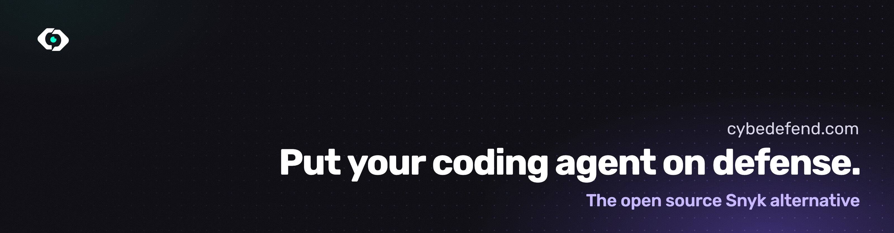
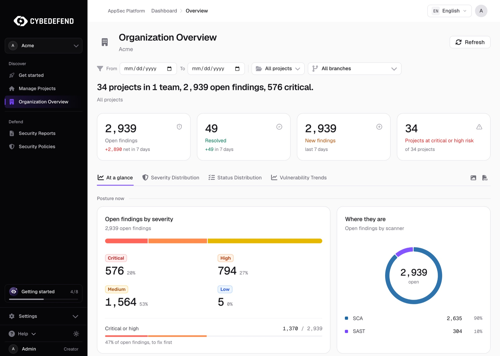
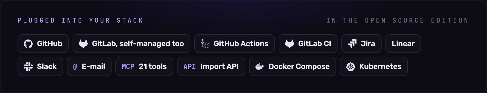

<p align="center">
  <a href="https://cybedefend.com"></a>
</p>

<p align="center"><strong>在编码智能体里敲一条命令，完成一次完整的安全审计，每个漏洞都有 exploit 为证。</strong><br>
开源的 Snyk 替代方案：自托管的智能体化 AppSec，AI 扫描器由你的编码智能体运行。</p>

<p align="center">
  <a href="https://github.com/CybeDefend/cybedefend/stargazers"></a>
  <a href="https://github.com/CybeDefend/cybedefend/tags"></a>
  <a href="LICENSE"></a>
  <a href="https://discord.gg/UPzm4n6SAJ"></a>
  <a href="https://www.linkedin.com/company/101144768"></a>
</p>

<p align="center"><a href="#quick-start">Install</a> &bull; <a href="deploy/community/README.md">Docs</a> &bull; <a href="https://cybedefend.com">Website</a> &bull; <a href="https://discord.gg/UPzm4n6SAJ">Discord</a></p>

<p align="center"><a href="README.md">English</a> &bull; <a href="README.fr.md">Français</a> &bull; <a href="README.zh-CN.md">中文</a> &bull; <a href="README.ja.md">日本語</a> &bull; <a href="README.ko.md">한국어</a> &bull; <a href="README.es.md">Español</a> &bull; <a href="README.pt-BR.md">Português</a></p>

> [!NOTE]
> 点个 Star，能让更多开发者发现这个仓库。我们将于 2026 年 12 月 4 日在 Product Hunt 上发布。欢迎来 [Discord](https://discord.gg/UPzm4n6SAJ) 和我们聊聊。

**① 一条命令，一次完整审计。**
在编码智能体里输入 `/cybedefend`。开源扫描器先跑，AI 扫描器去找它们看不到的问题，你的智能体再对照你的代码逐条判断每个发现项。它的回答是 **SHIP**，或者 **NOT YET**，并附上阻断项和每一项的修复方法。

**② 每个漏洞都经过证明。**
AI 扫描器把每个 exploit 写成测试，放进你仓库自己的测试套件里。发现项是事实，不是猜测。

**③ 背后是一整套开源 AppSec 平台。**
由你自己托管：给团队用的仪表盘、决定什么会阻断的策略、与你技术栈的集成，以及供编码智能体读取的 MCP 服务器。

<p align="center"></p>

<p align="center">如果它在你的代码里证明了一个漏洞，点个 Star 能帮其他开发者找到它。</p>

<br>

<a id="quick-start"></a>

# 快速开始

```bash
npx skills add CybeDefend/cybedefend -g
```

在要审计的仓库里打开你的编码智能体，输入：

```text
/cybedefend
```

安装到此结束。不用复制 token，不用改文件，不用启动服务器。

- **适用于** Claude Code、Codex、Cursor，以及所有能读取 skills 的编码智能体。
- **需要** Docker 处于运行状态，Docker Compose 2.24.4 或更高版本，约 4 GB 内存，以及 git 和 Node.js。
- **回答** **SHIP**，或者 **NOT YET**，并附上阻断项和每一项的修复方法。

<details>
<summary><b>首次运行会自动完成哪些配置</b></summary>

<br>

它什么都不问：

1. 用 Docker Compose 在你的机器上启动仪表盘，从 8080 起取第一个空闲端口，绑定到 `127.0.0.1`。第一次运行时，Docker 会下载镜像（约 6 GB，需要几分钟）。之后的运行只需几秒，不会改动任何东西。
2. 创建第一个管理员和一个个人访问令牌，保存在 `~/.cybedefend/appsec/credentials.json`（权限 600，从不打印）。
3. 为你的仓库创建项目；如果团队还没有策略，再创建一条默认策略：严重和高危发现项阻断，代码中的任何密钥也阻断，中危发现项只警告。
4. 把 MCP 服务器接入 Claude Code。如果用的是其他智能体，它会打印需要添加的地址。

如果拉取不到已发布的镜像，首次运行会从源码构建，并明确告知（15 到 30 分钟，仅此一次）。

</details>

<br>

# 工作原理

一条命令，五个步骤，一个结论。

| 步骤 | 发生了什么 |
|---|---|
| **1.&nbsp;扫描器** | 开源扫描器找出已知模式。 |
| **2.&nbsp;AI&nbsp;扫描器** | 你的编码智能体梳理每一个入口点，写下代码绝不允许发生的事，排查业务逻辑、访问权限、租户、身份和竞态条件，并用一个写进你自己测试套件的 exploit 测试来证明每个漏洞。 |
| **3.&nbsp;研判** | 你的智能体对照你的代码，逐条判断扫描器的每个发现项。 |
| **4.&nbsp;仪表盘** | 你的策略给出结论：**SHIP** 或 **NOT YET**。 |
| **5.&nbsp;报告** | 哪些在阻断，以及每一项的修复方法。 |

**AI 扫描器由你自己的编码智能体运行。** 不需要额外的模型，也不需要 API key。

**可以放心运行。** 审计不会修改任何应用代码。AI 扫描器不会向已部署的系统或第三方发送任何请求，也不使用真实凭据或个人数据。

<details>
<summary><b>AI 扫描器具体做什么</b></summary>

<br>

它列出代码的每一个入口点（路由、消息消费者、定时任务、webhook），每个一行，写明谁可以调用，以及由哪项检查来保证。它把代码的保证写成直白的句子：成员只能看到自己团队的文档，转账绝不会让余额低于零。

首次运行审查整个仓库。之后的运行审查分支改动的内容，以及能到达这些改动的入口点。范围内的每一行都会按角色逐一审查。

只有当你自己测试框架里的一个测试，因为线索所声称的原因而失败时，这条线索才成为发现项。其余线索都作为备注进入仪表盘，不会造成阻断。

报告会统计已审查的入口点、保留的发现项和搁置的发现项，并给出理由。

</details>

<details>
<summary><b>具体什么会阻断</b></summary>

<br>

策略可以作用于组织、团队或项目。策略用 YAML 编写，可以导入和导出。每条规则按严重程度、CVSS 评分、CWE、OWASP 类别、扫描器类型、存在时长或分支来匹配发现项，可以单独使用，也可以组合。

Block 规则会让结论变为 NOT YET，`/cybedefend` 以退出码 1 结束。Warn 规则会记录违规。每次扫描和每次导入结束时，策略都会重新判定。

</details>

<br>

# 平台

命令背后，是一套完整的开源 AppSec 平台。由你托管，团队在里面协作，你的编码智能体通过 MCP 服务器读取它。

### 一个视图看清整个组织

<p align="center"></p>

### 每个发现项，按分支查看

<p align="center"></p>

### 由你的策略决定什么会阻断

<p align="center"></p>

<details>
<summary><b>开源版包含的全部功能</b></summary>

<br>

| 功能 | 你能得到什么 |
|---|---|
| **跟随代码的发现项** | 扫描干净时自动解决，问题再次出现时重新打开 |
| **安全策略** | Block 和 Warn 规则，用 YAML 编写 |
| **组织、团队、角色** | 四种组织角色，四种团队角色 |
| **按项目的风险评分** | CybeRisk 等级，风险最高的排在最前 |
| **报告** | OWASP Top 10 和 CWE Top 25，支持 PDF、HTML 或 JSON |
| **MCP 服务器** | 为你的编码智能体提供 21 个工具 |
| **个人访问令牌** | 用于你的 CI、导入 API 和 MCP 服务器 |
| **自托管** | Docker Compose 和 PostgreSQL 18，运行在你的服务器上 |
| **不限席位，没有遥测** | 没有扫描配额，报告永久保留 |

</details>

<br>

# 集成

接入你的技术栈。

<p align="center"></p>

<details>
<summary><b>每个集成的作用</b></summary>

<br>

| 集成 | 作用 |
|---|---|
| **GitHub** | 一个由你创建的 GitHub App。关联仓库，扫描结束时创建 issue，其中的发现项全部解决后自动关闭；接入集群后，每次 push 都会扫描。 |
| **GitLab** | GitLab.com 或你自建的 GitLab，功能与 GitHub 相同。 |
| **Jira 和 Linear** | 从某个发现项创建工单，或在每次扫描结束时创建。 |
| **Slack 和电子邮件** | 扫描完成时发一条消息，另有周报和月报。 |
| **GitHub Actions 和 GitLab CI** | 每个 pull request 都运行扫描器，结果进入你的仪表盘。其他任何 CI 都可以用 `docker run` 运行它们。 |
| **编码智能体** | 两个 skill，适用于任何能读取 skills 的智能体，外加一个带 21 个工具的 MCP 服务器。 |
| **其他任何扫描器** | 任何 SARIF 2.1.0 文件，通过导入 API 或 `/cybedefend import` 上传，并可附带 CycloneDX SBOM 以获得完整的包列表。 |
| **Docker Compose 和 Kubernetes** | 平台用 Docker Compose 运行。接入一个 Kubernetes 集群后，平台会自己运行扫描，每个扫描器一个 pod。 |

每个集成都通过各自的配置项启用：[deploy/community/README.md](deploy/community/README.md) 列出了这些配置项，以及每个服务商的回调地址。

</details>

<br>

# 命令

每次部署前输入 `/cybedefend`。其他命令只运行其中一步，或者做得更深入。

| 命令 | 作用 |
|---|---|
| `/cybedefend` | 完整审计：首次运行审计整个仓库，之后审计分支改动的内容。 |
| `/cybedefend deep` | 重度审计，用于发版：对每个函数给出结论。 |
| `/cybedefend fix` | 修复阻断项，每个修复都由测试证明。 |
| `/cybedefend audit` | 重新审计整个仓库，再由两个没有参与编写审查结果的智能体进行复核。 |
| `/cybedefend scan` | 扫描器加结论。`--quick` 只运行核心扫描器。 |
| `/cybedefend triage` | 对照你的代码，逐条判断扫描器的每个发现项。 |
| `/cybedefend live` | 在你的机器上，用一次性数据，对你的应用重放已证明的漏洞。 |
| `/cybedefend import <file>` | 把其他工具的 SARIF 文件发送到你的仪表盘。 |
| `/cybedefend report` | 上一次运行的报告。 |
| `/cybedefend open` | 打开仪表盘和上一次运行的审计页面。 |
| `/cybedefend replay` | 按实际发生的过程，重新播放上一次运行的页面。 |
| `/cybedefend setup` | 只做配置。 |
| `/cybedefend-setup` | 第二个 skill：部署到服务器、启用 HTTPS，或在 Kubernetes 集群上运行扫描。 |

<br>

# 扫描器

一个团队需要的扫描器都在这里。运行哪些，由你仓库的技术栈决定。

<p align="center"></p>

这些是我们推荐的扫描器，其他任何扫描器也都能用。

| 领域 | 工具示例 |
|---|---|
| **代码** | Opengrep, Bandit, gosec, Brakeman<br><sub>源文件</sub> |
| **依赖** | Trivy，附带完整的包列表（SBOM）<br><sub>lockfile 或锁定的版本</sub> |
| **密钥** | Gitleaks<br><sub>git 能看到的文件</sub> |
| **基础设施即代码** | Trivy, Checkov<br><sub>Terraform, Kubernetes, Helm, Dockerfile, CloudFormation</sub> |
| **CI/CD** | zizmor, poutine<br><sub>GitHub Actions, GitLab CI, Azure Pipelines, Tekton</sub> |
| **容器** | Trivy<br><sub>你指定的镜像</sub> |

- **开源，由你选择**，每个工具一个镜像，都在 [`CybeDefend/cybedefend-scanners`](https://github.com/CybeDefend/cybedefend-scanners)。
- **你的机器上什么都不用装。**
- **外加所有能输出 SARIF 的扫描器**，使用 `/cybedefend import <file>`。

<details>
<summary><b>通过 SARIF 保留你现有的工具</b></summary>

<br>

| 领域 | 可以保留的工具 |
|---|---|
| **代码** | Semgrep, CodeQL, SonarQube, Snyk Code, ESLint security rules |
| **依赖** | Grype, osv-scanner, Snyk Open Source, OWASP Dependency-Check |
| **基础设施即代码** | KICS, tfsec, Terrascan, Kubescape |
| **密钥和 CI/CD** | TruffleHog, detect-secrets, actionlint |
| **其他** | 任何能输出 SARIF 2.1.0 的工具 |

</details>

<br>

# 全年随时可接受审计

SOC 2 和 ISO 27001 审计员要的证据，在你日常工作时就已留存。

| 审计员要什么 | CybeDefend 留存什么 |
|---|---|
| 漏洞得到及时处理<br><sub>ISO 27001 A.8.8, SOC 2 CC7.1</sub> | 每个发现项及其日期、严重程度和状态变更历史 |
| 安全编码与测试<br><sub>ISO 27001 A.8.28, A.8.29</sub> | 每个 pull request 的扫描，以及 AI 扫描器证明的每个漏洞及其测试 |
| 变更管理<br><sub>ISO 27001 A.8.25, SOC 2 CC8.1</sub> | 你的策略，在每次扫描和导入时判定，每次违规都有记录 |
| 审计证据 | PDF 格式的 OWASP Top 10 和 CWE Top 25 报告 |

<br>

# 文档

- **自托管指南**：[deploy/community/README.md](deploy/community/README.md)，包括 HTTPS 和反向代理、密钥、集成、升级、备份，以及如何验证镜像。
- **在 CI 中运行扫描器**：[CybeDefend/cybedefend-scanners](https://github.com/CybeDefend/cybedefend-scanners)。
- **构建与测试**：[CONTRIBUTING.md](CONTRIBUTING.md)。
- **报告漏洞**：[SECURITY.md](SECURITY.md)。

## 在你的 CI 中

[CybeDefend/cybedefend-scanners](https://github.com/CybeDefend/cybedefend-scanners) 的扫描器镜像在每个 pull request 上运行，并把结果发送到你的仪表盘。完整的 workflow、按 commit 锁定版本的方式和所有选项都写在那里。

你需要一个 runner 能访问到的实例、一个项目，以及一个有权在该项目上发起扫描的用户的个人访问令牌。

<details>
<summary><b>GitHub Actions</b>，每个扫描器一个 step</summary>

<br>

```yaml
- uses: CybeDefend/cybedefend-scanners@v1.0.0
  with:
    scanner: opengrep
    api-url: ${{ vars.CYBEDEFEND_API_URL }}
    project-id: ${{ vars.CYBEDEFEND_PROJECT_ID }}
    token: ${{ secrets.CYBEDEFEND_TOKEN }}
```

</details>

<details>
<summary><b>GitLab CI</b>，每个扫描器一个 job</summary>

<br>

```yaml
include:
  - remote: https://raw.githubusercontent.com/CybeDefend/cybedefend-scanners/v1.0.0/templates/gitlab/cybedefend-scanners.gitlab-ci.yml

sast:
  extends: .cybedefend-sast
```

</details>

<details>
<summary><b>其他任何 CI</b>，使用 <code>docker run</code> 或导入接口</summary>

<br>

用 `docker run` 加 `--upload` 运行扫描器镜像，或者带上个人访问令牌，把任意工具的 SARIF 发送到导入接口：

```bash
curl -H "Authorization: Bearer cdp_…" \
  -F file=@results.sarif -F type=sast -F branch=main \
  "$CYBEDEFEND_PUBLIC_URL/api/project/<projectId>/scan/import/start"
```

`type` 取 `sast`、`iac`、`secret`、`cicd`、`sca`、`container` 之一。

</details>

## 部署到服务器或 Kubernetes 集群

```text
/cybedefend-setup
```

这个配置 skill 会和你一起安装实例。它已经随同一条 `npx skills add` 一并装好了。

<details>
<summary><b>配置 skill 做什么</b></summary>

<br>

它检查 Docker 和它能看到的 Kubernetes 集群，为每个选项取默认值，只问它无法自行决定的事（是否在其中某个集群上运行扫描、服务器的域名），确认一次，然后写入配置、接入集群并启动整套服务。

接入集群后，实例会在自己专用的 namespace 里为每个扫描器启动一个 pod：**Start scan** 会出现在 **Import results** 旁边，上传的 ZIP 压缩包会被扫描，关联到 GitHub 或 GitLab 的项目可以在每次 push 时扫描。

</details>

<details>
<summary><b>手动安装</b></summary>

<br>

你需要 Docker Compose 2.24.4 或更高版本，以及约 4 GB 内存。整套服务自带 PostgreSQL 18。

```bash
git clone https://github.com/CybeDefend/cybedefend && cd cybedefend/deploy/community

# The master key: at least 32 random bytes, in a file readable by you alone.
(umask 077 && openssl rand -base64 32 > secret-key)
cp .env.example .env

# In .env, set the two required values:
#   CYBEDEFEND_SETUP_TOKEN  a long random string, for example: openssl rand -hex 32
#   CYBEDEFEND_PUBLIC_URL   the address users open, http://localhost:8080 by default
docker compose up -d
```

在 `CYBEDEFEND_PUBLIC_URL` 打开仪表盘，然后输入 `CYBEDEFEND_SETUP_TOKEN` 创建第一个管理员。

请备份主密钥（`secret-key`），并且永远不要更改它：它用于加密集成凭据、密钥类发现项和登录密钥。

</details>

<br>

# 创始团队

<table align="center">
  <tr>
    <td align="center" valign="top" width="200">
      <br>
      <b>Julien Zammit</b><br>
      <sub>联合创始人兼 CEO</sub><br>
      <a href="https://x.com/JulienZammit1">X</a> &bull; <a href="https://www.linkedin.com/in/julienzammit">LinkedIn</a>
    </td>
    <td align="center" valign="top" width="200">
      <br>
      <b>Florentin Ledy</b><br>
      <sub>联合创始人兼 CPTO</sub><br>
      <a href="https://www.linkedin.com/in/florentin-ledy">LinkedIn</a> &bull; <a href="https://github.com/FlorentinLedy">GitHub</a>
    </td>
    <td align="center" valign="top" width="200">
      <br>
      <b>Axel Paulin</b><br>
      <sub>联合创始人兼 COO</sub><br>
      <a href="https://www.linkedin.com/in/axel-paulin">LinkedIn</a>
    </td>
  </tr>
</table>

<br>

<p align="center">如果审计在你的代码里发现了问题，点个 Star 能帮其他开发者找到这个项目。</p>

<br>

# 参与贡献

欢迎提交 issue 和 pull request。请先阅读 [CONTRIBUTING.md](CONTRIBUTING.md)。
报告漏洞请按照 [SECURITY.md](SECURITY.md) 操作。
想和我们交流，请加入 [Discord](https://discord.gg/UPzm4n6SAJ)。

## 许可证

本项目以 GNU Affero General Public License v3（AGPL-3.0-only，见 LICENSE）开源。Copyright (C) 2026 CybeDefend SAS。网络条款（AGPL 第 13 条）：如果你修改了它，并让用户通过网络与之交互，你必须向这些用户提供修改后的源代码。本版本不发送任何遥测数据：没有任何数据会离开你的实例流向 CybeDefend。

[LICENSE](LICENSE) &bull; [THIRD_PARTY_NOTICES.md](THIRD_PARTY_NOTICES.md) &bull; [TRADEMARKS.md](TRADEMARKS.md) &bull; [CONTRIBUTING.md](CONTRIBUTING.md) &bull; [SECURITY.md](SECURITY.md)

<br>

<p align="center"><sub>AGPL-3.0-only。各扫描器保留其各自的许可证。由 <a href="https://cybedefend.com">CybeDefend</a> 打造。<br>Snyk 和 GitHub 是其各自所有者的商标。CybeDefend 与它们没有任何关联。</sub></p>
